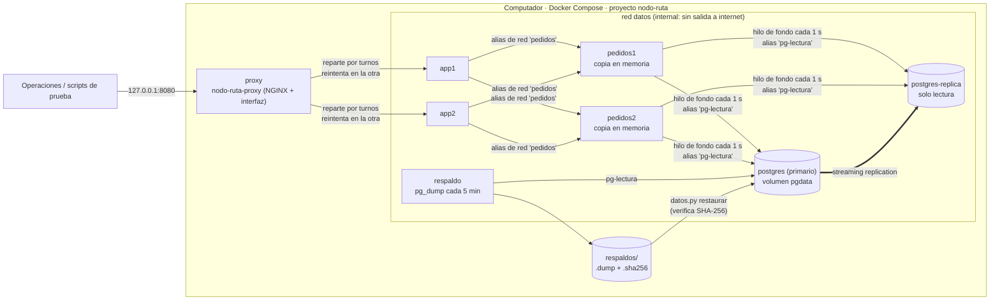
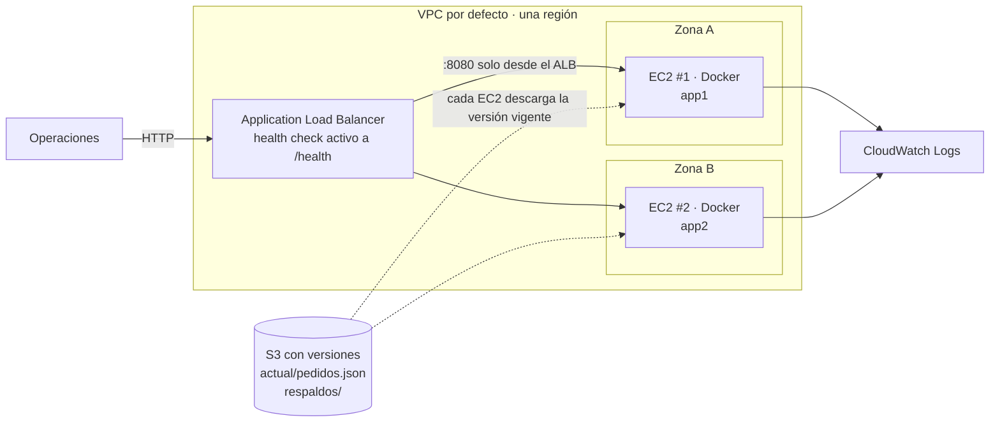

# 02 · Arquitectura

Dos partes: lo que corre **en local y está probado**, y el **diseño para AWS**, que todavía no se ha probado.

## 1. Local (probado)

| Pieza | Qué hace |
|---|---|
| `proxy` (NGINX + interfaz) | Único puerto publicado. Sirve la interfaz web en `/` y la API en `/pedidos` y `/health`. Reparte por turnos y, si una instancia no responde, reintenta en la otra (detección pasiva). Registra qué instancia atendió y cuánto tardó. No ve la red de datos. |
| `app1`, `app2` | La misma app con imágenes versionadas. Responden `instancia`, `version_app` y `servicio_datos`. Piden los datos por HTTP al alias `pedidos`. Se apagan de forma ordenada con SIGTERM. |
| `pedidos1`, `pedidos2` | Microservicio de solo lectura. Un hilo lee la base cada 1 s y las consultas responden desde memoria; si las dos bases caen, sirve la última lectura buena (marcada `degradado`) hasta 5 min. |
| `postgres` + `postgres-replica` | Primario y réplica en caliente (streaming replication). Sin puertos publicados; contraseña como Docker secret. Detalle y límites en [08-postgres-y-microservicio-pedidos.md](08-postgres-y-microservicio-pedidos.md). |
| `respaldo` | Cada 5 min ejecuta `pg_dump` con huella SHA-256. Lee de `pg-lectura`, así que sigue si el primario cae. |
| `scripts/desplegar.py` | Actualiza una instancia a la vez (pedidos1 → pedidos2 → app1 → app2) y revierte solo si la nueva falla. |
| Volúmenes y `respaldos/` | `pgdata` y `pgdata-replica` en volúmenes Docker; `respaldos/` en el disco del computador. No van al repositorio. |

> El diagrama visual [diagrama_solucion_local.html](diagrama_solucion_local.html) describe el stack anterior, con `data/pedidos.json`. Pendiente de regenerar con PostgreSQL; este diagrama Mermaid es el vigente.

### Interfaz web (frontend de Silvia)

`frontend-nodo/` es una interfaz en React + Vite, de **solo lectura**: muestra el estado de `/health`, lista los pedidos de `/pedidos` y busca por ID.

| Cómo se usa | Estado |
|---|---|
| Desarrollo: `npm run dev` en `frontend-nodo/`; Vite reenvía `/pedidos` y `/health` a `127.0.0.1:8080` | ✅ disponible |
| **Stack oficial:** `despliegue/Dockerfile.proxy` construye la interfaz dentro de Docker (no hace falta Node en el PC) y la imagen `nodo-ruta-proxy:<versión>` la sirve en `/`, mientras balancea `/pedidos` y `/health` | ✅ probado: 233 consultas con 0 errores durante una actualización escalonada |
| CI: `frontend.yml` (lint + build) y `contenedores.yml` (construye la referencia y hace una **prueba de punta a punta** de `despliegue/` en Linux) | ✅ |

`app.py` envía `Access-Control-Allow-Origin: *` y responde `OPTIONS`, para que la interfaz pueda consultar la API desde otro origen durante el desarrollo.

**Puntos únicos de falla en local:** el computador (primario y réplica comparten máquina), el proxy y la carpeta de respaldos en el mismo disco. Se tolera la caída de una instancia y de una base, no la de la máquina. Por eso esto es **tolerancia a la caída de una instancia**, no alta disponibilidad.

## 2. AWS, plan gratuito (diseño, por probar)

**Objetivo:** demostrar algo que en local es imposible: **apagar una máquina entera** y que el servicio siga respondiendo.

| Rol | Local | AWS | Qué mejora |
|---|---|---|---|
| Punto de acceso | NGINX | **ALB** | Lo administra AWS y vigila `/health` por su cuenta |
| Instancias | 2 contenedores en un PC | **2 EC2**, una por zona | Tolera la caída de una máquina |
| Datos | `data/pedidos.json` | **S3** (fuente de verdad) + copia en cada EC2 | No dependen de ninguna máquina |
| Respaldos | `respaldos/` en el mismo disco | **S3 con historial de versiones** | El respaldo vive fuera del cómputo |
| Registros | `docker compose logs` | **CloudWatch Logs** | Centralizados |
| Exposición | Solo `127.0.0.1:8080` | Security groups: EC2 solo acepta tráfico del ALB | Misma idea |
| Acceso de administración | — | **Session Manager** (sin SSH abierto) | Sin puerto 22 |

### Interfaz web en AWS (propuesta de Silvia)

**CloudFront** delante de todo, con dos comportamientos:
- la interfaz (`/`, `/assets/*`) se sirve desde un **bucket S3 de sitio estático**, con el build del workflow `frontend.yml`;
- la API (`/pedidos`, `/health`) se envía al **ALB**.

Así la interfaz y la API comparten origen (`VITE_API_URL` vacío) y se obtiene HTTPS en `*.cloudfront.net` sin comprar dominio. Con el caché desactivado para la API, las consultas siempre son en vivo. Es opcional: el MVP funciona sin la interfaz.

### PostgreSQL en AWS (decisión abierta, D13)

Con PostgreSQL, el diseño de datos de AWS cambia. Las opciones (una EC2 con todo el stack, 2 EC2 + RDS, o primario y réplica en EC2 distintas) y la propuesta están en D13 de [03-decisiones.md](03-decisiones.md). **El diagrama de AWS de arriba todavía muestra los datos como JSON en S3**; se redibuja al cerrar D13. Lo que sí se mantiene: ALB, 2 EC2 en dos zonas, CloudWatch Logs y S3 para los respaldos.

### Cómo llegan los datos a cada EC2 (diseño con JSON, anterior a D12)

1. La versión vigente vive en `s3://<bucket>/actual/pedidos.json`.
2. En cada EC2, una tarea programada cada pocos segundos descarga el archivo a un temporal, lo valida y lo **reemplaza de forma atómica** en `/opt/nodoruta/data/`. Funciona porque montamos la **carpeta**, igual que en `despliegue/`.
3. La app relee el archivo en cada consulta, así que se entera sola.
4. **Restaurar** = volver a poner una versión anterior del objeto como vigente. Las dos EC2 la toman en el siguiente ciclo. El RTO incluye ese intervalo y hay que medirlo.

Los pedidos no se "suben a la app": se publica una nueva versión del archivo en S3. Mientras dura la sincronización, una EC2 puede mostrar `datos-v1` y la otra `datos-v2`; el campo `version` permite verlo y medirlo. Si los pedidos cambiaran a cada rato desde muchos puntos, haría falta una base de datos (fase 2, ver [03-decisiones.md](03-decisiones.md)).

### Correcciones al borrador anterior

- **Ruta de datos:** el borrador montaba `/opt/nodoruta/data:/app/data`, pero la app lee `DATA_PATH=/data/pedidos.json`. Habría leído la copia que trae la imagen y la prueba de restauración no habría servido. Se monta en `/data`.
- **Permisos:** la EC2 solo **lee** S3 (`s3:GetObject` en `actual/*`). Quien restaura es una persona del equipo con su propio usuario, no la máquina.
- **Créditos:** en el plan gratuito actual, el ALB, las EC2 y las IP públicas **consumen créditos por hora**. El esquema anterior de "750 h gratis" ya no aplica a cuentas nuevas.
- **Imagen:** se construye **una vez** y se publica en un registro. No se construye en cada EC2, porque podrían salir versiones distintas.

### Lo que hay que saber antes de probar I02 en AWS

El ALB **no reintenta** en otra instancia cuando una conexión falla, como sí hace NGINX. Si se mata una EC2 de golpe, puede haber algunos 502 hasta que el health check la marque como caída. Con un intervalo de 5 s y un umbral de 2, eso son unos 10 s. Con un apagado ordenado, el *deregistration delay* del ALB más el SIGTERM de la app deberían dar 0 errores. **Se mide y se reporta tal cual.**

### Decisiones abiertas para el despliegue

| Decisión | Opciones | Propuesta |
|---|---|---|
| Región | us-east-1 u otra | La de menor latencia con todo disponible en el plan gratuito |
| Registro de imagen | GHCR público / ECR | GHCR público: sin costo y sin secretos en la imagen |
| Cómo se crea la infraestructura | Consola / scripts / CloudFormation | 🟢 **CloudFormation** en `infra/aws/` (D14): crear y **destruir** con una pila |
| Intervalo de sincronización con S3 | 5–30 s | 10 s; cada revisión es una solicitud a S3, así que también cuenta como costo |
| HTTPS e interfaz | Sin dominio / CloudFront delante del ALB y del S3 de la interfaz | CloudFront: da `https://*.cloudfront.net` y sirve el frontend |

## 3. Probado vs. diseñado

| Mecanismo | Estado |
|---|---|
| 2 instancias + proxy + conmutación | ✅ Probado en local |
| Datos fuera del contenedor | ✅ Probado en local |
| Respaldo automático y restauración verificada | ✅ Probado en local |
| Despliegue sin caída y rollback | ✅ Probado en local (Windows y Linux) |
| PostgreSQL + microservicio de pedidos (2 réplicas) | ✅ Probado en local (STG01–STG14, Windows) |
| Caída del primario sin errores | ✅ Probado en local (STG08, STG14) |
| Caída de las dos bases con copia en memoria | ✅ Probado en local (STG12) |
| Acceso de GitHub Actions a AWS sin claves (OIDC) | ✅ Probado (rol sin permisos, solo `main`) |
| Tolerancia a la caída de la máquina que aloja la base | ⏳ Diseño AWS (D13) |
| Promoción automática de la réplica | ❌ No implementada, a propósito (riesgo de *split-brain*) |
| Tolerancia a la caída de una **máquina** | ⏳ Diseño AWS, por probar |
| Health check activo | ⏳ Diseño AWS (ALB) |
| Respaldos fuera del computador | ⏳ Diseño AWS (S3) |
| HTTPS | ⏳ Opcional (CloudFront) |
| Tolerancia a la caída de una región | ❌ Fuera de alcance (el reto no lo exige) |
