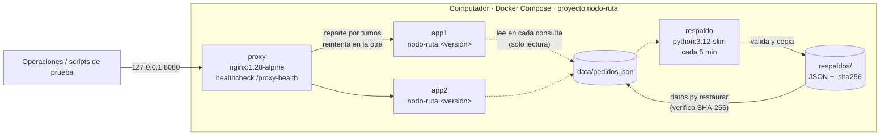
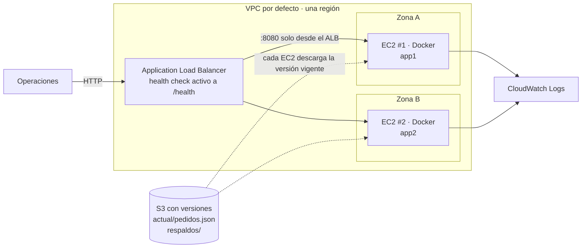

# 02 · Arquitectura

Dos partes: lo que corre **en local y está probado**, y el **diseño para AWS**, que todavía no se ha probado.

## 1. Local (probado)

| Pieza | Qué hace |
|---|---|
| `proxy` (NGINX) | Único puerto publicado. Reparte por turnos y, si una instancia no responde, reintenta en la otra (detección pasiva). Registra qué instancia atendió y cuánto tardó. |
| `app1`, `app2` | La misma app con imágenes versionadas. Responden `instancia` y `version_app`. Se apagan de forma ordenada con SIGTERM. |
| `respaldo` | Cada 5 min ejecuta `datos.py respaldar`. Si el JSON está dañado, no respalda. |
| `scripts/desplegar.py` | Actualiza una instancia a la vez y revierte solo si la nueva falla. |
| `data/` y `respaldos/` | En el disco del computador, fuera de los contenedores. No van al repositorio. |

**Puntos únicos de falla en local:** el computador, el proxy, el archivo de datos compartido y la carpeta de respaldos en el mismo disco. Por eso esto es **tolerancia a la caída de una instancia**, no alta disponibilidad.

## 2. AWS, plan gratuito (diseño, por probar)

**Objetivo:** demostrar algo que en local es imposible: **apagar una máquina entera** y que el servicio siga respondiendo.

| Rol | Local | AWS | Qué mejora |
|---|---|---|---|
| Punto de acceso | NGINX | **ALB** | Lo administra AWS y vigila `/health` por su cuenta |
| Instancias | 2 contenedores en un PC | **2 EC2**, una por zona | Tolera la caída de una máquina |
| Datos | `data/pedidos.json` | **S3** (fuente de verdad) + copia en cada EC2 | No dependen de ninguna máquina |
| Respaldos | `respaldos/` en el mismo disco | **S3 con historial de versiones** | El respaldo vive fuera del cómputo |
| Registros | `docker compose logs` | **CloudWatch Logs** | Centralizados |
| Exposición | Solo `127.0.0.1:8080` | Security groups: EC2 solo acepta tráfico del ALB | Misma idea |
| Acceso de administración | — | **Session Manager** (sin SSH abierto) | Sin puerto 22 |

### Cómo llegan los datos a cada EC2

1. La versión vigente vive en `s3://<bucket>/actual/pedidos.json`.
2. En cada EC2, una tarea programada cada pocos segundos descarga el archivo a un temporal, lo valida y lo **reemplaza de forma atómica** en `/opt/nodoruta/data/`. Funciona porque montamos la **carpeta**, igual que en `despliegue/`.
3. La app relee el archivo en cada consulta, así que se entera sola.
4. **Restaurar** = volver a poner una versión anterior del objeto como vigente. Las dos EC2 la toman en el siguiente ciclo. El RTO incluye ese intervalo y hay que medirlo.

Los pedidos no se "suben a la app": se publica una nueva versión del archivo en S3. Mientras dura la sincronización, una EC2 puede mostrar `datos-v1` y la otra `datos-v2`; el campo `version` permite verlo y medirlo. Si los pedidos cambiaran a cada rato desde muchos puntos, haría falta una base de datos (fase 2, ver [03-decisiones.md](03-decisiones.md)).

### Correcciones al borrador anterior

- **Ruta de datos:** el borrador montaba `/opt/nodoruta/data:/app/data`, pero la app lee `DATA_PATH=/data/pedidos.json`. Habría leído la copia que trae la imagen y la prueba de restauración no habría servido. Se monta en `/data`.
- **Permisos:** la EC2 solo **lee** S3 (`s3:GetObject` en `actual/*`). Quien restaura es una persona del equipo con su propio usuario, no la máquina.
- **Créditos:** en el plan gratuito actual, el ALB, las EC2 y las IP públicas **consumen créditos por hora**. El esquema anterior de "750 h gratis" ya no aplica a cuentas nuevas.
- **Imagen:** se construye **una vez** y se publica en un registro. No se construye en cada EC2, porque podrían salir versiones distintas.

### Lo que hay que saber antes de probar I02 en AWS

El ALB **no reintenta** en otra instancia cuando una conexión falla, como sí hace NGINX. Si se mata una EC2 de golpe, puede haber algunos 502 hasta que el health check la marque como caída. Con un intervalo de 5 s y un umbral de 2, eso son unos 10 s. Con un apagado ordenado, el *deregistration delay* del ALB más el SIGTERM de la app deberían dar 0 errores. **Se mide y se reporta tal cual.**

### Decisiones abiertas para el despliegue

| Decisión | Opciones | Propuesta |
|---|---|---|
| Región | us-east-1 u otra | La de menor latencia con todo disponible en el plan gratuito |
| Registro de imagen | GHCR público / ECR | GHCR público: sin costo y sin secretos en la imagen |
| Cómo se crea la infraestructura | Consola / scripts con AWS CLI | Scripts en `infra/aws/` para crear y **destruir** de forma reproducible |
| Intervalo de sincronización con S3 | 5–30 s | 10 s; cada revisión es una solicitud a S3, así que también cuenta como costo |
| HTTPS | Sin dominio / CloudFront delante del ALB | Opcional: CloudFront da `https://*.cloudfront.net` |

## 3. Probado vs. diseñado

| Mecanismo | Estado |
|---|---|
| 2 instancias + proxy + conmutación | ✅ Probado en local |
| Datos fuera del contenedor | ✅ Probado en local |
| Respaldo automático y restauración verificada | ✅ Probado en local |
| Despliegue sin caída y rollback | ✅ Probado en local (Windows y Linux) |
| Tolerancia a la caída de una **máquina** | ⏳ Diseño AWS, por probar |
| Health check activo | ⏳ Diseño AWS (ALB) |
| Respaldos fuera del computador | ⏳ Diseño AWS (S3) |
| HTTPS | ⏳ Opcional (CloudFront) |
| Tolerancia a la caída de una región | ❌ Fuera de alcance (el reto no lo exige) |
