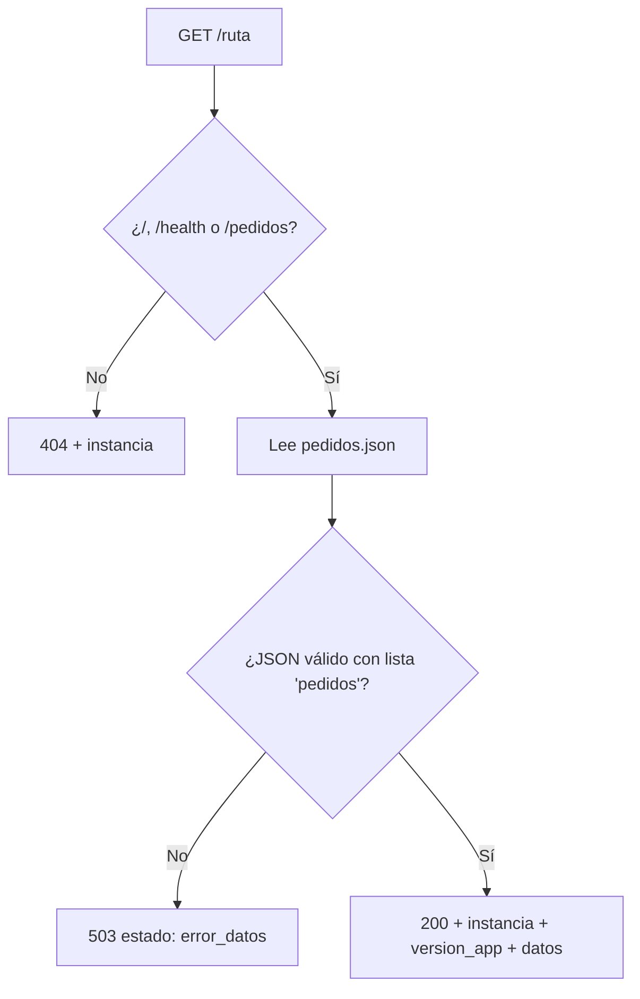

# 05 · Cómo funciona todo (guía para explicarlo)

Para entender cada pieza y poder defenderla ante el jurado. Describe el stack oficial (`despliegue/`).

## 1. La idea en una frase

Una app Python pequeña lee `pedidos.json` **en cada consulta** y responde en JSON diciendo **qué instancia** y **qué versión** contestó. Hay dos instancias detrás de NGINX, que reparte las consultas y, si una falla, reintenta en la otra. Los datos viven fuera de los contenedores y un servicio aparte los respalda cada 5 minutos.

## 2. Mapa del repositorio

| Ruta | Qué es |
|---|---|
| `app.py`, `Dockerfile`, `pedidos.json` | La app del reto (con cambios mínimos), su imagen y los datos **originales** (no se tocan) |
| `despliegue/compose.yaml`, `despliegue/nginx.conf` | El stack oficial: app1, app2, proxy y respaldo |
| `scripts/desplegar.py` | Despliegue escalonado y rollback |
| `scripts/datos.py` | Preparar, respaldar, dañar (para probar) y restaurar los datos |
| `scripts/verificar_servicio.py`, `scripts/monitorear.py` | Generan la evidencia de las pruebas |
| `despliegue/Dockerfile.proxy` | Imagen del proxy: construye la interfaz web y la sirve con NGINX |
| `ayuda_opcional/` | Configuración de referencia del reto, tal como llegó (no es la oficial) |
| `frontend-nodo/` | Interfaz web React + Vite de solo lectura (pedidos, búsqueda por ID, estado) |
| `.github/workflows/` | CI: lint y build del frontend; validar y construir los contenedores |
| `data/`, `respaldos/` | Copia de trabajo y respaldos. Se crean al usar los scripts; **no van al repo** |
| `evidencias/` | Resultados de las pruebas (JSON y TXT) |

## 3. La aplicación (`app.py`)

**Configuración por variables de entorno.** Gracias a esto, una misma imagen sirve para las dos instancias.

| Variable | Para qué | Valor en el contenedor |
|---|---|---|
| `DATA_PATH` | Dónde está el archivo de datos | `/data/pedidos.json` |
| `INSTANCE_ID` | Nombre de la instancia; si falta, usa el hostname | `app1` / `app2` |
| `APP_VERSION` | Versión del código; la fija `desplegar.py` al construir | `v1`, `v2`… |
| `PORT` | Puerto | `8080` |

**Qué hace con cada consulta** (`GET`; `OPTIONS` responde 204 para CORS; otros métodos reciben 501):



```json
GET /health  → {"estado": "ok", "instancia": "app1", "version_app": "v1", "version_datos": "datos-v1"}
GET /pedidos → {"instancia": "app2", "version_app": "v1", "version": "datos-v1", "pedidos": [ ... ]}
```

**Lo que hay que saber explicar:**
1. **Relee el archivo en cada consulta, sin caché.** Al restaurar, la app responde con los datos nuevos al instante, sin reiniciar. Por eso el RTO medido es de 157 ms.
2. **`/health` es un chequeo profundo:** no dice solo "estoy viva", comprueba que puede leer datos válidos.
3. **Con datos dañados fallan las tres rutas** (todas leen el archivo).
4. **Apagado ordenado:** al recibir SIGTERM (`docker stop`, un despliegue) deja de aceptar conexiones y termina las que tiene en curso. Sin esto, Python como proceso principal del contenedor ignora la señal y Docker lo mata a los 10 s.
5. **CORS:** cada respuesta lleva `Access-Control-Allow-Origin: *` y la app responde `OPTIONS`, para que la interfaz web pueda llamarla desde otro origen en desarrollo.
6. **Registros:** una línea por consulta en la consola. Docker la captura y se ve con `logs`.
7. **Servidor de laboratorio:** `ThreadingHTTPServer` no es para producción, y lo decimos.

## 4. La imagen (`Dockerfile`)

```dockerfile
FROM python:3-slim                      # ⚠ pendiente fijar a python:3.12-slim
WORKDIR /app
COPY app.py /app/app.py
COPY pedidos.json /data/pedidos.json    # copia "de fábrica"; el montaje la tapa
ENV DATA_PATH=/data/pedidos.json PYTHONUNBUFFERED=1
ARG APP_VERSION=dev                     # desplegar.py pasa --build-arg APP_VERSION=v2
ENV APP_VERSION=${APP_VERSION}
USER 10001                              # sin privilegios
CMD ["python", "app.py"]
```

La imagen trae su propia copia de `pedidos.json`, que era justo el problema del caso. Compose monta la carpeta `data/` del computador **encima** de `/data`, así que la app lee los datos externos.

## 5. El stack (`despliegue/compose.yaml`)

| Servicio | Imagen | Puntos clave |
|---|---|---|
| `app1`, `app2` | `nodo-ruta:${APP1_TAG}` / `${APP2_TAG}` | Cada una puede tener una versión distinta durante un despliegue. Montan `../data` en solo lectura. Healthcheck a `/health` cada 5 s (cada 1 s al arrancar). `restart: unless-stopped`. **Sin `ports:`** |
| `proxy` | `nodo-ruta-proxy:${PROXY_TAG:-1.0.0}` (NGINX + interfaz, se construye con `Dockerfile.proxy`) | Publica `${NODO_IP:-127.0.0.1}:${NODO_PUERTO:-8080}`. Healthcheck propio en `/proxy-health`. Arranca cuando las dos apps están sanas |
| `respaldo` | `python:3.12-slim` | Bucle: `datos.py respaldar` y espera 300 s. Lee `data/`, escribe en `respaldos/` |

- **No se levanta con `compose up` a mano:** lo hace `desplegar.py`, que escribe las versiones en `despliegue/.env`.
- **Por qué se monta la carpeta y no el archivo:** el montaje de un solo archivo queda atado a ese archivo exacto. Si se reemplazara por otro, el contenedor seguiría viendo el viejo. Montando la carpeta se puede hacer un reemplazo atómico, que es lo que haremos en AWS.
- **El healthcheck no reinicia nada:** solo informa (`healthy`/`unhealthy`). Quien reinicia un proceso caído es `restart:`, y quien deja de mandarle tráfico es NGINX.

## 6. El proxy (`despliegue/nginx.conf`)

```nginx
resolver 127.0.0.11 valid=2s ipv6=off;           # DNS de Docker; re-pregunta cada 2 s
upstream aplicaciones {
    zone aplicaciones 64k;
    server app1:8080 resolve max_fails=1 fail_timeout=3s;
    server app2:8080 resolve max_fails=1 fail_timeout=3s;
}
location = /proxy-health { return 200 "ok\n"; }  # salud del propio proxy
location / { try_files $uri $uri/ /index.html; } # interfaz web
location ~ ^/(pedidos|health)$ {
    proxy_pass http://aplicaciones;              # reparto por turnos
    proxy_connect_timeout 300ms;                 # si no conecta en 300 ms, prueba la otra
    proxy_read_timeout 3s;
    proxy_next_upstream error timeout http_502 http_503 http_504;
    proxy_next_upstream_tries 2;
}
```

- **`resolve` + `valid=2s`:** al recrear un contenedor su IP cambia; NGINX la vuelve a resolver rápido.
- **`max_fails=1 fail_timeout=3s`:** con un fallo, esa instancia queda fuera del reparto 3 s.
- **`proxy_next_upstream`:** si una instancia falla, NGINX repite la consulta en la otra antes de responder. Es seguro porque las consultas solo leen.
- **Detección pasiva:** NGINX se entera del fallo cuando le manda tráfico real; no vigila `/health`.
- **Pendiente:** con `http_503` en la lista, si los datos se dañan las dos instancias quedan castigadas y el usuario ve 502 en vez del 503 de la app. Se corrige quitando `http_503`.

## 7. Los scripts

| Script | Comandos | Detalle |
|---|---|---|
| `desplegar.py` | `desplegar --version v2`, `rollback [--version v1]`, `estado` | Construye la imagen, actualiza app1, verifica salud + versión + que el proxy la usa, luego app2. Si algo falla, revierte lo tocado. Códigos de salida 0/1/2 (listo para CI) |
| `datos.py` | `preparar`, `respaldar`, `simular-error`, `restaurar --respaldo respaldos/X.json` | Restaurar exige que el archivo esté en `respaldos/`, que la huella SHA-256 coincida y que el JSON sea válido |
| `verificar_servicio.py` | `--esperadas app1,app2 --salida evidencias/X.json` | 10 consultas seguidas; `CUMPLE` si todas son 200 y aparecen las instancias esperadas |
| `monitorear.py` | `--segundos 90 --salida evidencias/X.json` | Consultas continuas cada 0,1 s durante un despliegue; resume errores y cambios de versión |

## 8. Qué pasa cuando algo falla

| Escenario | Qué ve el usuario | Quién lo detecta | Qué lo recupera |
|---|---|---|---|
| Cae app1 | Responde app2, sin errores | NGINX, al fallar una consulta | `restart:` (si el proceso murió) o `start` |
| Se recrea app1 | Nada; los datos siguen ahí | — | Los datos están fuera |
| Se dañan los datos | Error en **las dos** instancias | `/health` | `datos.py restaurar` |
| Versión nueva rota | Nada; sigue la versión anterior | `desplegar.py` | Rollback automático |
| Cae NGINX | Servicio caído | Su healthcheck | `restart:` |
| Cae el computador | Todo caído | — | Nada en local: es lo que resuelve AWS |

## 9. Preguntas probables del jurado

- **¿Por qué la segunda instancia no salvó el caso de los datos dañados?** Porque las dos leen el mismo archivo: es un fallo compartido. Contra eso protege el respaldo, no la redundancia.
- **¿Persistir es lo mismo que respaldar?** No. Persistir es que los datos sobrevivan al recrear el contenedor. Respaldar es tener una copia anterior verificada a la que volver.
- **¿Esto es alta disponibilidad?** No. En local es tolerancia a la caída de una instancia. En AWS, con dos máquinas en zonas distintas, toleraríamos la caída de una máquina o de una zona, pero no de la región.
- **¿Cómo saben qué versión responde?** Por `version_app` en cada respuesta, y por el historial de `desplegar.py estado`.
- **¿Por qué solo se publica un puerto?** Para que la única entrada sea el proxy.
