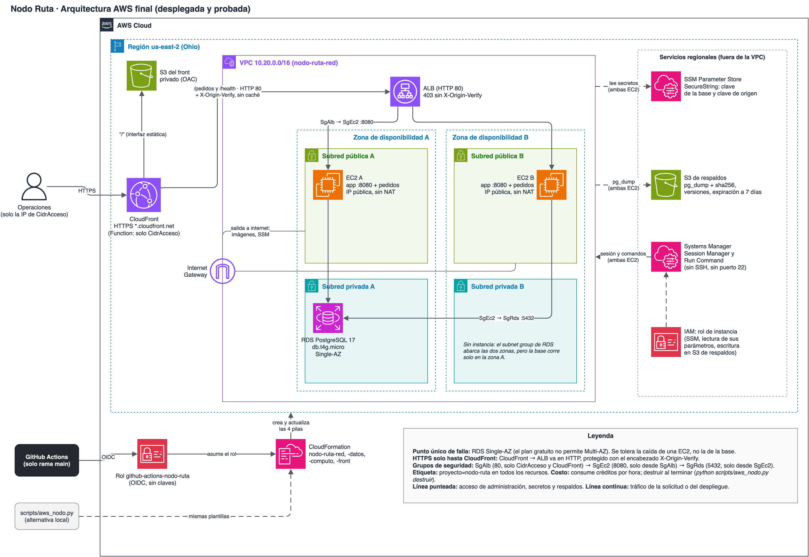

# 06 · Pitch final: Nodo Ruta

> Versión del 27-11-2026. Cada número sale de [EVIDENCIAS.md](../EVIDENCIAS.md) y lleva su ID. Lo que no está medido se dice como tal. Quién habla en cada parte queda como [asignar] hasta que el equipo lo defina.

**Presentación y guion:** las slides están en [`presentacion/pitch.html`](../presentacion/pitch.html) y el guion para ensayar en [`presentacion/guion.html`](../presentacion/guion.html); se abren con doble clic y funcionan sin internet. El esquema común está en [`presentacion/ESQUEMA.md`](../presentacion/ESQUEMA.md).

## Duración

La guía del reto (`recursos-reto/GUIA_ESTUDIANTE.md`) no fija la duración del pitch ni da criterios de evaluación. Usamos **5 minutos** (objetivo), con la demo en un video aparte que se enlaza (`docs/09-guion-video-aws.md`, aún por grabar). Si la organización confirma otro tiempo, se ajusta la columna de minutos.

| # | Sección | Tiempo | Quién |
|---|---|---|---|
| 1 | El problema y quién lo vive | 0:40 | [asignar] |
| 2 | Qué necesitaba el negocio | 0:30 | [asignar] |
| 3 | La solución: local y AWS | 0:50 | [asignar] |
| 4 | La demo | 0:50 | [asignar] |
| 5 | Los números medidos | 0:50 | [asignar] |
| 6 | Seguridad y costos | 0:40 | [asignar] |
| 7 | Límites honestos | 0:40 | [asignar] |
| 8 | Cierre y próximos pasos | 0:20 | [asignar] |
| | **Total** | **5:00** | |

## 1. El problema (0:40)

Nodo Ruta es una empresa ficticia de distribución urbana con un servicio web de consulta de entregas que corre en **una sola instancia**, con los datos dentro de la app. Lo viven tres actores:

- **Operaciones** consulta entregas; si el servicio cae, busca información por otros medios.
- **El responsable técnico** publica versiones y atiende incidentes; hoy reinicia y busca una copia.
- **Coordinación logística** necesita saber si el servicio funciona y qué límites tiene.

> "Si la única instancia cae, operaciones se queda sin consultar entregas. Y nadie sabe cuánto tarda en volver ni si los datos que vuelven son los correctos."

## 2. Qué necesitaba el negocio (0:30)

No pidió "cinco nueves". Pidió tres cosas que se pueden medir:

1. Que la caída de un servidor **no se note** o se note poco.
2. **Datos correctos**: detectar un dato dañado y recuperarlo desde una copia verificada.
3. Recuperación en un **tiempo conocido**, medido con scripts y no estimado.

> "Nos preguntamos: cuando algo falla, ¿operaciones sigue consultando, y el responsable técnico recupera la versión correcta en un tiempo que podemos decir en voz alta? Y lo medimos."

## 3. La solución: local y AWS (0:50)

Diagrama de AWS: 

| | Local (Docker Compose) | AWS (us-east-2, CloudFormation) |
|---|---|---|
| Punto de acceso | NGINX en `127.0.0.1:8080` | CloudFront (HTTPS) hacia un ALB |
| Instancias | `app1` y `app2` + microservicio `pedidos1/2` | 2 EC2 en dos zonas (`us-east-2a` y `us-east-2b`) |
| Datos | PostgreSQL primario + réplica | RDS PostgreSQL Single-AZ |
| Respaldo | `pg_dump` con SHA-256 | `pg_dump` a S3 con SHA-256 y versiones |
| Despliegue | `scripts/desplegar.py` con rollback | `scripts/aws_nodo.py` o GitHub Actions (4 pilas) |

> "En local, dos instancias detrás de NGINX, con la base de datos aparte, respaldo verificado y despliegue sin caída. En AWS, lo mismo con piezas de nube: dos servidores en dos zonas detrás de un balanceador, base de datos administrada, respaldos en S3 y la interfaz por CloudFront con HTTPS. Todo es código: se levanta y se destruye con un comando."

Importante: en local, dos contenedores en un mismo computador dan **tolerancia a la caída de una instancia**, nada más: si se apaga el computador, se cae todo. La caída de una máquina completa solo se pudo probar en AWS.

## 4. La demo (0:50)

Video: [pendiente de grabar; el guion está en `docs/09-guion-video-aws.md`]. Enlace del video: [agregar cuando exista].

Escenas del guion (≈ 5 min completos; en el pitch se muestra un resumen de ~50 s o se enlaza):

1. Despliegue desde GitHub Actions (OIDC, sin claves).
2. La interfaz por HTTPS, con el campo `instancia` alternando entre `us-east-2a` y `us-east-2b`.
3. Las 4 pilas, los 2 destinos `healthy`, RDS y S3 en la consola.
4. `aws_nodo.py estado`.
5. Se detiene una EC2 en vivo con el monitor corriendo.
6. Destrucción de todo.

> "Aquí vemos la consulta repartiéndose entre dos zonas. Ahora detenemos un servidor y miramos qué ve un usuario: unos pocos errores en los primeros segundos y después nada, hasta que el servidor vuelve solo."

## 5. Los números medidos (0:50)

| ID | Qué se probó | Resultado medido |
|---|---|---|
| I02 | Caída de app1 (local) | 10 de 10 consultas con 200, 0 errores; una consulta tardó 1015 ms por el reintento de NGINX |
| I05c | Datos alterados y restauración (local) | Restauración en 110 ms; primer 200 correcto a los 157 ms; el reparto entre las dos instancias tarda hasta 5 s más |
| I07 | Versión nueva sin caída y rollback (local) | 708 consultas, 0 errores; despliegue en 11,8 s y rollback en 9,4 s |
| I08 | Versión rota, rollback automático (local) | Revertida en 4,2 s; 345 consultas, 0 errores. Falta guardar el archivo de evidencia |
| STG08 | Caída del primario de PostgreSQL (local) | 418 consultas, 0 errores (la réplica se lee en vivo) |
| AWS04 | Caída de una EC2 (AWS) | 299 consultas, **5 errores (1,7 %)**, todos entre 2,1 s y 9,8 s tras la parada; después 0 errores; la EC2 volvió sola en 40,6 s |
| AWS06b | Restauración desde S3 (AWS) | Primer 200 a los 8,6 s de la orden, con datos `datos-v1` y 6 pedidos |
| AWS09 | Despliegue desde GitHub Actions (AWS) | Ejecución exitosa en 4 min 29 s con red, datos y cómputo ya creados; desde cero, ~16 min (suma de pasos) |
| AWS10 | Destrucción desde GitHub Actions (AWS) | Todo borrado en 8 min 28 s |

> "El servidor local recuperó los datos en menos de un segundo. En AWS, una caída de servidor costó cinco errores en unos diez segundos y volvió solo en 40 segundos. Restaurar desde S3 tardó 8,6 segundos. Levantar toda la infraestructura desde cero toma unos 16 minutos y destruirla, 8."

## 6. Seguridad y costos (0:40)

| Control | Cómo |
|---|---|
| GitHub entra a AWS sin claves | OIDC; el rol `github-actions-nodo-ruta` solo acepta este repositorio en la rama `main` (AWS09, AWS10) |
| Secretos fuera del repositorio | La contraseña de la base vive en SSM Parameter Store (SecureString) |
| Sin SSH | Las EC2 no tienen puerto 22; se administran con Session Manager (SSM) |
| Exposición mínima | Las EC2 solo aceptan tráfico del ALB; RDS solo de las EC2 y sin acceso público |
| Filtro por IP | CloudFront y el ALB solo dejan entrar a la IP del integrante (`CidrAcceso`) |
| Topes de costo en la política | El rol solo puede lanzar EC2 `t3.micro` o `t4g.micro` y RDS `db.t4g.micro` o `db.t3.micro` (`infra/aws/iam/politica-github-actions.json`) |
| Presupuesto | Alerta `nodo-ruta-mensual` de USD 5 al mes, con avisos al 50 % y al 100 % (docs/07) |
| Destruir al terminar | AWS10: todo borrado y verificado |

**Costo:** no medimos el costo en AWS. `docs/04-seguridad-y-costos.md` lista los factores sin cifras, y `docs/09-guion-video-aws.md` da una referencia aproximada de USD 2 al día de créditos con todo encendido (precios de lista, sin verificar en la facturación). Por eso se destruye el mismo día.

> "Sin claves guardadas, sin SSH, con acceso limitado por IP y con tope de tamaño de máquinas en la política. El costo lo controlamos creando para probar y destruyendo al terminar."

## 7. Límites honestos (0:40)

- **La base en AWS es un punto único de falla.** RDS Single-AZ, porque el plan gratuito no permite Multi-AZ (D13). Multi-AZ es solo diseño.
- **Hay errores durante la caída de un servidor.** AWS04: 5 errores (1,7 %) en una ventana de ~8 s, porque el ALB no reintenta en la otra instancia hasta que su health check saca a la caída.
- **Registramos los fallos tal cual.** AWS06: la restauración falló y el servicio quedó en 503; el incidente completo duró ~8,5 min por un defecto del script, corregido y repetido en AWS06b. El primer intento de AWS09 también falló (faltaba un permiso de CloudFront). AWS10 terminó en fallo por un falso positivo de la verificación final, ya corregido.
- **Solo diseño, no probado:** el rechazo de otras IP en CloudFront y el ALB, HTTPS propio con dominio (de CloudFront al ALB va en HTTP), autoescalado y alarmas de monitoreo.
- **En local solo hay tolerancia a la caída de una instancia:** las dos copias corren en el mismo computador.
- I06 sigue parcial: falta que alguien despliegue siguiendo solo el README.

> "Lo que no cubrimos: si cae la base de datos en AWS, el servicio depende de ella. Y cuando cae un servidor, hay unos segundos con errores. Preferimos decirlo y mostrar el número."

## 8. Cierre y próximos pasos (0:20)

> "Entregamos un servicio que tolera la caída de un servidor, datos que se pueden verificar y restaurar, y tiempos medidos. Lo que sigue: Multi-AZ para la base, HTTPS con dominio, alarmas y reducir los errores de la caída con un health check más rápido."

Próximos pasos: Multi-AZ en RDS (con plan de pago), dominio y certificado, alarmas, health check más agresivo o sacar la instancia del target group antes de una parada planificada (mejora indicada en AWS04), y cerrar los pendientes de la Fase 2 de [07-plan-y-fases.md](07-plan-y-fases.md).

## Preguntas probables del jurado

| Pregunta | Respuesta corta | Evidencia |
|---|---|---|
| ¿Por qué no Multi-AZ? | El plan gratuito de RDS solo permite Single-AZ y la regla del reto es cero costos. La base es un punto único de falla y lo decimos | D13, `docs/03-decisiones.md` |
| ¿Por qué no ECS ni Kubernetes? | El reto premia un MVP medido; con 2 servicios, dos EC2 detrás de un ALB bastan. Kubernetes está fuera del alcance. Además la política de la organización limita las regiones y servicios | D13, D15, CLAUDE.md |
| ¿Qué pasa si cae la base? | En local, la caída del primario no produjo errores porque se lee la réplica; si caen ambas, el microservicio sirve su copia en memoria. En AWS no hay réplica: solo la copia en memoria cubre caídas cortas y no se promete el 0 errores | STG08, STG12, D13 |
| ¿Cuánto cuesta? | No lo medimos. Referencia de lista de unos USD 2 al día con todo encendido, sin verificar; se destruye al terminar y hay alerta de USD 5 al mes | `docs/09`, AWS10 |
| ¿Por qué 5 errores durante la caída? | El ALB no reintenta en otra instancia: hasta que su health check (2 × 5 s) saca a la EC2 caída, algunas consultas fallan. Todos los errores cayeron entre 2,1 y 9,8 s tras la parada; después 0 | AWS04 |
| ¿Cómo evitan que alguien entre directo al balanceador? | El ALB solo acepta la lista de prefijos de CloudFront; su listener responde 403 salvo con un encabezado secreto o desde la IP permitida. Es una mitigación, no un control fuerte; el rechazo de otras IP está diseñado, no probado | AWS08, D16 |
| ¿Cómo sabemos que el respaldo sirve? | Se verifica el SHA-256 y se lee el índice con `pg_restore --list`; AWS06b restauró y devolvió 6 pedidos | AWS05, AWS06b |
| ¿Qué falló y qué aprendieron? | AWS06 falló por un defecto del script de restauración; ensayar la restauración antes de necesitarla lo descubrió | AWS06, AWS06b |
| ¿Se puede repetir? | Sí: un comando o un botón en Actions, y destruir con otro | AWS09, AWS10 |
| ¿El servicio ya no se cae nunca? | No lo prometemos. Tolera la caída de una instancia (local) o de un servidor (AWS), con los errores medidos y con la base como punto único de falla en AWS | EVIDENCIAS.md, cierre |

## Frase para coordinación logística (público no técnico)

> "Si se cae uno de los dos servidores, las consultas siguen funcionando después de unos segundos con algunos errores. Si los datos se dañan, los recuperamos en segundos y verificamos que sean los correctos. Lo que no cubrimos hoy: la caída de la base de datos en la nube."

## Si preguntan por el cambio frente a la ficha

La ficha inicial proponía microservicios y PostgreSQL; se descartaron (D9) y se retomaron (D12) con 14 pruebas medidas (STG01–STG14). Más piezas que operar es el costo que reconocemos.
