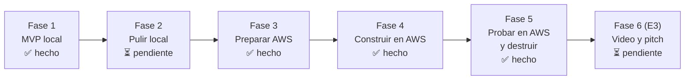

# 07 · Estado y próximas fases

> Actualizado el 27-11-2026. Cuando se cierre una tarea, márquenla aquí en el mismo PR.

## Dónde estamos

El servicio está **implementado y probado en local** (Docker Compose con PostgreSQL) y **implementado, probado y destruido en AWS** (4 pilas de CloudFormation, evidencias AWS01 a AWS10). Hoy no hay nada encendido en AWS. Lo que falta es pulir algunos detalles locales y entregar: grabar el video y presentar el pitch.

Los números salen solo de [EVIDENCIAS.md](../EVIDENCIAS.md).

## Fases

La Fase 2 se dejó para después de AWS porque no bloquea nada: son mejoras medidas en local que no cambian lo probado en la nube.

### Fase 1 · MVP local: ✅ hecho

| Pieza | Qué es | Evidencia |
|---|---|---|
| 2 instancias de la app | `app1` y `app2`, la misma imagen; cada respuesta dice `instancia` y `version_app` | I01 |
| Proxy NGINX | Único puerto (`127.0.0.1:8080`); reparte y reintenta si una instancia falla | I02, I02b, I03 |
| Interfaz web | React + Vite de solo lectura, servida por el proxy | I07b |
| Datos fuera del contenedor | Primero JSON montado en solo lectura; hoy PostgreSQL con volumen | I04, STG01–STG14 |
| Respaldo y restauración | SHA-256 verificado antes de restaurar; respaldo automático | I05, I05c, I05d, STG05 |
| Despliegue sin caída y rollback | `desplegar.py`: una instancia a la vez, rollback automático si falla | I07, I07b, I08, STG01–STG04, STG11 |
| PostgreSQL + microservicio de pedidos | Primario + réplica en caliente; copia en memoria del microservicio | STG06–STG14 |
| CI en GitHub Actions | `frontend.yml` y `contenedores.yml` (prueba de punta a punta de `despliegue/`) | checks de cada PR |

### Fase 2 · Pulir lo local: ⏳ pendiente

Estado verificado en el repo el 27-11-2026:

| Tarea | Por qué | Estado | Responsable |
|---|---|---|---|
| Fijar `python:3.12-slim` | Reproducibilidad (`python:3-slim` instalaba 3.15) | ✅ Hecho: `Dockerfile` y `servicios/pedidos/Dockerfile` usan `python:3.12-slim` (D15) | — |
| Quitar `http_503` de `proxy_next_upstream` | Con datos dañados el usuario ve 502 y las instancias quedan fuera hasta 3 s | ⏳ Pendiente: `despliegue/nginx.conf` todavía lo lista | [asignar] |
| `server_tokens off` | No mostrar la versión de NGINX | ⏳ Pendiente: no aparece en `despliegue/nginx.conf` | [asignar] |
| Endurecer contenedores (`cap_drop`, `no-new-privileges`) | Menos privilegios | ⏳ Pendiente: `compose.yaml` solo tiene `read_only` en algunos servicios | [asignar] |
| `desplegar.py levantar` | Encender la versión guardada tras un `down` | ⏳ Pendiente: el comando no existe en `scripts/desplegar.py` | [asignar] |
| Guardar la evidencia de I08 | Es la única prueba local sin archivo | ⏳ Pendiente: no hay `evidencias/I08_*` | [asignar] |
| **I06 completa:** alguien que no haya tocado el código despliega siguiendo solo el README | La exige la guía del reto | ⏳ Parcial (ver EVIDENCIAS.md) | [asignar] |

### Fase 3 · Preparar AWS: ✅ hecho

| Tarea | Estado |
|---|---|
| Alerta de presupuesto | ✅ `nodo-ruta-mensual`, USD 5 al mes sin contar créditos, avisos al 50 % y al 100 % |
| Acceso de GitHub a AWS sin claves | ✅ OIDC: rol `github-actions-nodo-ruta`, solo acepta este repo en `main` |
| Política de despliegue del rol | ✅ **Aplicada**; versionada en `infra/aws/iam/politica-github-actions.json` |
| Dónde vive PostgreSQL | ✅ D13: 2 EC2 + RDS PostgreSQL Single-AZ (el plan gratuito no permite Multi-AZ) |
| Región | ✅ Solo `us-east-2` (una política de la organización bloquea EC2, CloudFormation, RDS, ELB y ECS en las demás) |
| Cómo se sirve la interfaz | ✅ D16: CloudFront + S3 |
| Etiqueta común | ✅ `proyecto=nodo-ruta` en todo |

### Fase 4 · Construir en AWS: ✅ hecho

Lo que se construyó (la lista anterior, con JSON en S3 y GHCR, quedó superada por D13, D15, D16 y D17):

| Pieza | Qué es | Evidencia |
|---|---|---|
| `nodo-ruta-red` (`01-red.yaml`) | VPC, 2 subredes públicas y 2 privadas, grupos de seguridad | AWS01 |
| `nodo-ruta-datos` (`02-datos.yaml`) | RDS PostgreSQL 17 Single-AZ cifrada, bucket S3 de respaldos, contraseña en SSM | AWS02 |
| `nodo-ruta-computo` (`03-computo.yaml`) | 2 EC2 en dos zonas (app + pedidos en contenedores, sin SSH), ALB con health check a `/health` | AWS03 |
| `nodo-ruta-front` (`04-front.yaml`) | S3 privado + CloudFront con HTTPS; `/pedidos` y `/health` van al ALB | AWS08 |
| `scripts/aws_nodo.py` | `desplegar`, `estado`, `probar`, `destruir` y `--simular` (D17) | AWS09, AWS10 |
| `.github/workflows/aws.yml` | Lo mismo desde GitHub Actions con OIDC, solo desde `main` | AWS09, AWS10 |
| Diagrama | `docs/arquitectura/aws-final.png` (editable en `aws-final.drawio`) | — |

### Fase 5 · Probar en AWS y destruir: ✅ hecho

| ID | Prueba | Resultado (de EVIDENCIAS.md) |
|---|---|---|
| AWS01 | Crear la pila de red | Cumple |
| AWS02 | Crear la pila de datos | Cumple |
| AWS03 | Reparto entre dos zonas detrás del ALB | Cumple |
| AWS04 | Caída de una EC2 y recuperación | Cumple: 299 consultas, 5 errores (1,7 %) en una ventana de 2,1 a 9,8 s tras la parada; 0 después; la EC2 volvió sola en 40,6 s |
| AWS05 | Respaldo a S3 con comprobación | Cumple, ~13 s |
| AWS06 | Alteración y restauración desde S3, primer intento | **No cumple**: la restauración falló y el servicio quedó en 503 (corregido en `166ca8a`) |
| AWS06b | Restauración con la corrección | Cumple: primer 200 a los 8,6 s de la orden |
| AWS07 | Destrucción manual | Cumple, ~9 min (snapshot automático de RDS por verificar) |
| AWS08 | Interfaz y API por CloudFront | Cumple (HTTP a HTTPS, sin caché en la API) |
| AWS09 | Despliegue completo desde GitHub Actions | Cumple tras un primer intento fallido (permiso de CloudFront); 4 min 29 s con las pilas de red, datos y cómputo ya creadas |
| AWS10 | Destrucción desde GitHub Actions | Cumple: todo borrado en 8 min 28 s; la verificación final dio un falso positivo (corregido) |

### Fase 6 · Encuentro 3: video y pitch: ⏳ pendiente

| Tarea | Estado |
|---|---|
| Grabar el video de la demo | ⏳ Pendiente. Guion en [09-guion-video-aws.md](09-guion-video-aws.md); exige volver a desplegar y destruir el mismo día |
| Pitch | ✅ Guion escrito en [06-pitch.md](06-pitch.md); ⏳ falta ensayarlo y asignar quién dice cada parte |
| Mejoras elegidas | ✅ Rollback; ✅ auto-recuperación (`restart: unless-stopped`, medida en AWS04); ✅ interfaz que muestra el estado; ⏳ video |

## Probado vs. diseñado

| Mecanismo | Dónde | Estado | Evidencia |
|---|---|---|---|
| 2 instancias + proxy, reparto y conmutación sin errores | Local | ✅ Probado | I01, I02, I02b, I03 |
| Datos que sobreviven a recrear un contenedor | Local | ✅ Probado | I04 |
| Respaldo, alteración y restauración verificada con SHA-256 | Local | ✅ Probado | I05, I05c (157 ms), I05d, STG05 |
| Despliegue sin caída, rollback manual y automático | Local | ✅ Probado | I07, I07b, I08 (sin archivo de evidencia), STG04, STG11 |
| PostgreSQL primario + réplica; caída del primario | Local | ✅ Probado | STG07, STG08, STG14 |
| Caída de ambas bases con copia en memoria | Local | ✅ Probado | STG12 |
| Repetición por otra persona siguiendo el README del equipo | Local | 🟡 Parcial | I06 |
| Reparto entre 2 EC2 en dos zonas detrás del ALB | AWS | ✅ Probado | AWS03 |
| Caída de una EC2: errores acotados y recuperación sola | AWS | ✅ Probado (con 5 errores medidos) | AWS04 |
| Respaldo a S3 fuera del cómputo y de la base | AWS | ✅ Probado | AWS05 |
| Restauración desde S3 | AWS | ✅ Probado tras corregir el fallo de AWS06 | AWS06, AWS06b |
| HTTPS al visitante por CloudFront y API sin caché | AWS | ✅ Probado (CloudFront a ALB va en HTTP) | AWS08 |
| Despliegue y destrucción automatizados con OIDC, sin claves | AWS | ✅ Probado | AWS09, AWS10 |
| Rechazo de otras IP y del encabezado falso o ausente en CloudFront y ALB | AWS | 🟡 Solo diseño: no se pudo simular desde la IP permitida | AWS08 |
| Tolerancia a la caída de la base | AWS | ❌ No cubierta: RDS Single-AZ es un punto único de falla (D13) | — |
| RDS Multi-AZ | AWS | 🟡 Solo diseño: exige un plan de pago | — |
| HTTPS propio con dominio, y HTTPS entre CloudFront y el ALB | AWS | 🟡 Solo diseño | — |
| Autoescalado | AWS | ❌ No implementado | — |
| Monitoreo y alarmas (CloudWatch) | AWS | ❌ No implementado: solo health check del ALB y el monitor de los scripts | — |
| Promoción automática de la réplica | Local | ❌ No implementada, a propósito (riesgo de *split-brain*) | — |
| Caída de una región | — | ❌ Fuera de alcance | — |
