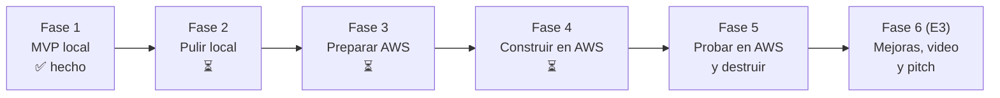

# 07 · Estado y próximas fases

> Actualizado el 21-11-2026. Cuando se cierre una tarea, márquenla aquí en el mismo PR.

## Lo que tenemos (probado en local)

| Pieza | Qué es | Evidencia |
|---|---|---|
| **2 instancias de la app** | `app1` y `app2`, la misma imagen `nodo-ruta:<versión>`; cada respuesta dice `instancia` y `version_app` | I01 |
| **Proxy NGINX** | Único puerto (`127.0.0.1:8080`). Sirve la interfaz web en `/` y reparte `/pedidos` y `/health` entre las dos instancias, con reintento si una falla | I02, I07b |
| **Interfaz web** | React + Vite de solo lectura (estado, pedidos, búsqueda por ID), construida dentro de la imagen del proxy | I07b |
| **Datos fuera del contenedor** | `data/pedidos.json` montado en solo lectura; el original del reto queda intacto | I04 |
| **Respaldo automático** | Contenedor `respaldo`: copia + SHA-256 cada 5 min; nunca respalda un archivo dañado | I05, respaldo automático |
| **Restauración verificada** | `datos.py restaurar` comprueba la huella antes de escribir; el servicio vuelve en 157 ms | I05c, I05d |
| **Despliegue sin caída + rollback** | `desplegar.py`: una instancia a la vez, rollback automático si la nueva falla | I07 (0 errores en 708 consultas), I08 |
| **CI en GitHub Actions** | Build del frontend + prueba de punta a punta del despliegue en Linux en cada PR | checks de los PR #7 y #8 |
| **PostgreSQL + microservicio de pedidos** | `pedidos1`/`pedidos2` (solo lectura, copia en memoria), primario + réplica en caliente, respaldo con `pg_dump`. Tolera la caída de una base | STG01–STG14 |
| **Documentación** | `docs/01` a `docs/08`, `EVIDENCIAS.md`, README | — |

**Lo que todavía no está demostrado:** que el servicio sobreviva a la caída de una **máquina** completa, el health check activo, los respaldos fuera del computador y HTTPS. Todo eso es el objetivo de AWS.

## Fases

### Fase 2 · Pulir lo local (un PR pequeño, ~1 h)

| Tarea | Por qué | Responsable |
|---|---|---|
| `desplegar.py levantar` para encender la versión guardada después de un `down`, y corregir el mensaje que hoy sugiere `rollback` | Hoy, tras un `down`, el script obliga a inventar una versión nueva | [asignar] |
| Quitar `http_503` de `proxy_next_upstream` | Con datos dañados el usuario ve 502 y las instancias quedan fuera hasta 3 s | [asignar] |
| Fijar `python:3.12-slim` en el `Dockerfile` y `server_tokens off` | Reproducibilidad (hoy instala 3.15) y no mostrar la versión de NGINX | [asignar] |
| Guardar la evidencia de I08 (`evidencias/I08_rollback_automatico.json`) | Es la única prueba sin archivo | [asignar] |
| **I06 completa:** alguien que no haya tocado el código despliega siguiendo solo el README | La exige la guía del reto | [asignar] |

### Fase 3 · Preparar AWS (antes de crear cualquier recurso)

| Tarea | Detalle |
|---|---|
| **Alerta de presupuesto** | ✅ Hecha (21-11): `nodo-ruta-mensual`, USD 5 al mes sin contar créditos, avisos al 50 % y al 100 % |
| **Acceso de GitHub a AWS sin claves** | ✅ OIDC probado (21-11): rol `github-actions-nodo-ruta`, solo `main`, sin permisos todavía |
| **Dónde vive PostgreSQL en AWS** | Abierta: D13 en `docs/03`. Bloquea el diseño de la fase 4 |
| Usuarios IAM para el equipo | Nadie trabaja con el usuario raíz; permisos mínimos |
| Decidir la región | La más cercana con todo lo necesario en el plan gratuito |
| **Decidir cómo se sirve la interfaz** | (a) CloudFront + S3, que da HTTPS gratis pero suma dos servicios; o (b) la misma imagen `nodo-ruta-proxy` en cada EC2 detrás del ALB, que reutiliza lo ya probado pero no tiene HTTPS. Ver `docs/02` |
| Registro de imágenes | Propuesta: GHCR público, publicado desde GitHub Actions (sin costo y sin secretos) |
| Etiqueta común | `proyecto=nodo-ruta` en todo, para encontrarlo y borrarlo |
| Rama `staging` | Su contenido (PostgreSQL + microservicio) se integra a `main`; después se puede borrar la rama |

### Fase 4 · Construir en AWS (`infra/aws/`)

Plantillas de **CloudFormation** en `infra/aws/` para crear y destruir con una pila (D14):

1. **S3** con versiones: `actual/pedidos.json` y `respaldos/`.
2. **Imagen** construida una sola vez y publicada (GitHub Actions → GHCR).
3. **Rol IAM** para las EC2: solo lectura de `actual/*` en S3 y escritura de logs.
4. **2 EC2** en dos zonas, con Docker, la app montando `/data` y una tarea que sincroniza desde S3 cada 10 s con reemplazo atómico.
5. **ALB** + target group con health check a `/health`. Security groups: las EC2 solo aceptan tráfico del ALB y no tienen SSH (se usa Session Manager).
6. **CloudWatch Logs** con retención corta.
7. (Según la decisión de la fase 3) CloudFront + S3 para la interfaz.

> Los puntos 1, 3 y 4 asumían los datos como JSON en S3. Con PostgreSQL cambian según D13; esta lista se reescribe al decidirlo.

### Fase 5 · Probar en AWS y destruir

| Prueba | Qué demuestra |
|---|---|
| I01–I05 en la nube | Lo mismo que en local, ahora con el ALB y S3 |
| **Apagar una EC2 completa** | Tolerancia a la caída de una máquina, imposible de demostrar en local |
| Restaurar una versión anterior en S3 | Respaldo fuera del cómputo; RTO medido, incluido el intervalo de sincronización |
| Medir errores durante la caída | El ALB no reintenta como NGINX: se reporta lo que salga, tal cual |
| **Destruir todo** y revisar facturación | Regla de costo cero (lista en `docs/04`) |

### Fase 6 · Encuentro 3: mejoras y pitch

- **Mejoras elegidas:** rollback (✅ hecho), auto-recuperación (en AWS: `restart:` + health check del ALB), página de estado (✅ la interfaz ya muestra el estado) y **video de la demo** (grabar local y AWS antes de destruir).
- Guion del pitch en `docs/06-pitch.md`, con los números finales de `EVIDENCIAS.md`.
- Tabla final de **probado vs. diseñado** actualizada.
