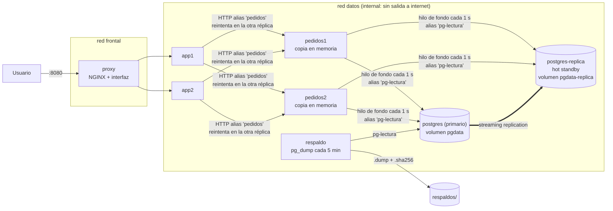

# 08 · PostgreSQL y microservicio de pedidos

Desarrollado en la rama `staging` (Steban) e integrado a `main`. Reemplaza los datos fijos en `data/pedidos.json` por una base **PostgreSQL** a la que se accede a través de un **microservicio HTTP**. Es la fase 2 que D9 dejó pendiente; ver D12 en [03-decisiones.md](03-decisiones.md).

Las pruebas del stack con JSON (I01–I08) siguen en `EVIDENCIAS.md`; las de este stack son STG01–STG14. `app.py` funciona en los dos modos: sin `PEDIDOS_URL` lee el archivo JSON como antes.

## Arquitectura



### ¿Por qué PostgreSQL era un punto único de falla y cómo se resolvió?

En la primera versión había **una sola base**. La capa de apps tenía 2 réplicas y la de pedidos también, pero si la base caía, las cuatro respondían 503. Se añadieron tres capas de defensa:

| Capa | Qué cubre | Medido |
|---|---|---|
| **Réplica en caliente** (`postgres-replica`, streaming replication) | Caída o reinicio del primario: se sigue leyendo **en vivo** de la réplica | STG08 / STG14: primario detenido 20–25 s, **0 errores** |
| **Copia en memoria** en cada réplica de pedidos | Caída de **las dos** bases: se sirve la última lectura correcta, marcada `degradado`, hasta 5 min | STG12: ambas bases detenidas 30 s, **0 errores**, máx. 63 ms |
| **Las consultas nunca esperan a la base** | Una base lenta o un DNS que tarda: un hilo de fondo lee la base cada 1 s y las consultas responden desde memoria | STG09 falló (504) antes de este cambio |

Lo que **no** se tapa: si los datos se dañan (por ejemplo, se borra la tabla), la copia se descarta y el servicio responde 503 (STG13). Un daño tiene que verse para poder restaurarlo.

Además:
- **Sumas de verificación** (`--data-checksums`) para detectar corrupción en disco. Solo aplica a bases nuevas.
- **`wal_keep_size=256MB`** para que la réplica se ponga al día tras una caída.
- Las reglas de acceso (`basedatos/pg_hba.conf`) se pasan por parámetro, así que también valen para una base que ya existía, sin reinicializarla.
- El respaldo lee de `pg-lectura`: si el primario cae, los respaldos siguen.

**Escrituras:** solo el primario acepta escrituras; por ahora solo las usan `datos.py restaurar` y `simular-error`. Si el primario se perdiera para siempre, la réplica se puede promover a primario a mano:
```text
docker compose -f despliegue/compose.yaml exec postgres-replica pg_ctl promote -D /var/lib/postgresql/data
```
No se automatiza a propósito: promover sin coordinación puede dejar dos primarios con datos distintos (*split-brain*). Se haría con Patroni o con RDS Multi-AZ, fuera del alcance de staging.

| Pieza | Imagen | Qué hace |
|---|---|---|
| `proxy` | `nodo-ruta-proxy` | Igual que antes: único puerto publicado, interfaz web y reparto entre app1 y app2. No ve la red de datos. |
| `app1`, `app2` | `nodo-ruta:<versión>` | API pública (`/pedidos`, `/health`) con el **mismo contrato** que antes, más el campo `servicio_datos` (qué réplica de pedidos respondió). Piden los datos por HTTP a `http://pedidos:8081`. |
| `pedidos1`, `pedidos2` | `nodo-ruta-pedidos:<versión>` | Microservicio de solo lectura ([servicios/pedidos/](../servicios/pedidos/)). Un hilo lee la base cada 1 s (psycopg 3, conexión de solo lectura, consultas cortadas a los 2 s) y las consultas responden desde memoria. Comparten el alias de red `pedidos`. |
| `postgres` | `postgres:17.6-alpine` | Primario. Datos en el volumen `pgdata`. El esquema y los 6 pedidos sintéticos se cargan desde [basedatos/init/](../basedatos/init/) la primera vez. Sin puertos publicados. |
| `postgres-replica` | `postgres:17.6-alpine` | Réplica de solo lectura con streaming replication. La primera vez se copia sola del primario ([basedatos/replica/](../basedatos/replica/)). Comparte con el primario el alias `pg-lectura`. |
| `respaldo` | `postgres:17.6-alpine` | `pg_dump` cada 5 min a `respaldos/` con su SHA-256; nunca deja un respaldo a medias. |

Credenciales: usuario `cualquieraInc` (variable `DB_USUARIO`) y contraseña en `despliegue/secretos/db_password.txt`, que se entrega a los contenedores como **Docker secret** y no va al repositorio ni a las imágenes.

### Por qué el alias `pedidos` y no `pedidos1,pedidos2`

En la primera versión las apps llamaban a `pedidos1` y `pedidos2` por nombre. La prueba STG02 dio un 504: mientras `pedidos1` se recreaba, su nombre no existía y **resolverlo tardó 7,8 s** en la red interna (medido). El `timeout` de HTTP no cubre esa espera. Con un alias compartido, el nombre siempre existe, el DNS de Docker devuelve al instante la IP de cada réplica viva y la app las prueba en orden. Con el cambio, STG04 repitió la misma prueba con 0 errores.

## Uso

```text
python scripts/datos.py preparar                        # una vez: pide la contraseña de la base (o NODO_DB_PASSWORD)
python scripts/desplegar.py desplegar --version v1      # postgres, pedidos1/2, app1/2, proxy y respaldo
python scripts/desplegar.py desplegar --version v2      # actualización escalonada: pedidos1, pedidos2, app1, app2
python scripts/desplegar.py rollback
python scripts/datos.py respaldar | verificar | simular-error
python scripts/datos.py restaurar --respaldo respaldos/<archivo>.dump
```

`pg_dump`, `pg_restore` y `psql` se ejecutan dentro del contenedor `postgres`: no hace falta instalar PostgreSQL en el equipo. `restaurar` comprueba la huella SHA-256 y que el archivo sea un respaldo de `pg_dump`, y restaura en una sola transacción: o queda todo o no cambia nada.

Para empezar con la base vacía (vuelve a cargar los datos iniciales), **borrando los datos actuales** del primario y de la réplica:
```text
docker compose -f despliegue/compose.yaml down -v
```
No borrar solo uno de los dos volúmenes: una réplica que apunte a un primario nuevo no puede seguirlo. Si pasa, borrar también `nodo-ruta_pgdata-replica` y la réplica se vuelve a copiar sola.

Comprobar la replicación:
```text
docker compose -f despliegue/compose.yaml exec postgres psql -U cualquieraInc -d nodo_ruta -c "SELECT client_addr, state FROM pg_stat_replication"
```

## Resultados medidos (21-11-2026, Windows 11 + Docker Desktop)

Monitor con una consulta a `/pedidos` cada 0,1 s a través del proxy. Detalle en [EVIDENCIAS.md](../EVIDENCIAS.md#staging-microservicios--postgresql).

| ID | Prueba | Consultas | Errores | Latencia máx. |
|---|---|---|---|---|
| STG01 | Actualización escalonada de 4 instancias (stg-v1 → stg-v2), 15,3 s | 487 | **0** | 1047 ms |
| STG02 | Versión rota de pedidos → rollback automático (antes del alias) | 355 | 1 (504) | 3016 ms |
| STG03 | Despliegue de la corrección (stg-v2 → stg-v4) | 352 | 1 (504, código anterior) | 3016 ms |
| STG04 | Versión rota de pedidos → rollback automático (con alias) | 328 | **0** | 1031 ms |
| STG05 | Respaldo → borrar tabla → restaurar | — | 503 esperado durante el daño | restauración 0,6 s |
| STG06 | Reinicio de PostgreSQL (aún sin réplica) | 239 | **0** | 953 ms |
| STG07 | Transición del stack en marcha a primario + réplica (stg-v4 → stg-v6) | 983 | **0** | 2953 ms (solo en la transición) |
| STG08 | Primario detenido 25 s (con réplica) | 418 | **0** | 79 ms |
| STG09 | Ambas bases detenidas, con lectura en la consulta | 116 | 2 (504) → hallazgo | 2031 ms |
| STG10 | Despliegue con refresco en segundo plano | 419 | 2 (504/502 de NGINX) → hallazgo | 1031 ms |
| STG11 | Dos despliegues seguidos (con pausa de 3,5 s entre apps) | 625 | **0** | 1032 ms |
| STG12 | Ambas bases detenidas 30 s (corregido) | 505 | **0** | 63 ms |
| STG13 | Daño en los datos con copia en memoria → sigue dando 503; restauración | — | 503 esperado | servicio de vuelta en 3,2 s |
| STG14 | Primario detenido 20 s (código final) | 381 | **0** | 47 ms |

## PostgreSQL en AWS (diseño, por probar)

> **Decisión abierta (D13 en [03-decisiones.md](03-decisiones.md)).** Lo que sigue es la opción más simple, una sola EC2 con todo el stack, y se escribió antes de que la nube pasara a implementación con CloudFormation. Con una sola máquina **no** se demuestra la caída de una máquina, que es el objetivo del diseño de AWS (ver [02-arquitectura.md](02-arquitectura.md)). Se reescribe al cerrar D13.

Para staging basta **una EC2** con Docker que corra este mismo `compose.yaml`. Así se valida el stack completo sin crear recursos administrados.

1. EC2 con Docker Engine y el plugin Compose, en la región elegida. Etiqueta `proyecto=nodo-ruta` y alerta de presupuesto **antes** de crearla.
2. Security group: solo el puerto del proxy (80 u 8080) abierto, idealmente solo a las IP del equipo. **Nunca** el 5432. Administración por Session Manager, sin SSH abierto.
3. En el servidor:
   ```bash
   git clone <repo> && cd proyecto_hackaton_cualquiera_inc
   NODO_DB_PASSWORD='<contraseña>' python3 scripts/datos.py preparar
   export NODO_IP=0.0.0.0
   python3 scripts/desplegar.py desplegar --version stg-$(git rev-parse --short HEAD)
   ```
4. Respaldos fuera de la máquina: copiar `respaldos/*.dump` a un bucket S3 con versiones (fase siguiente).

A tener en cuenta:
- **Memoria:** el stack corre 2 PostgreSQL, 4 procesos Python y NGINX; en reposo cabe en 1 GB, pero construir la interfaz (`npm ci` + `vite build`) en una instancia de 1 GB puede quedarse sin memoria. Opciones: una instancia de 2 GB, añadir swap, o construir las imágenes en GitHub Actions y publicarlas en GHCR.
- **RDS** solo vale la pena si se necesita una base administrada. Para usarla basta cambiar `DB_HOST` en `pedidos1` y `pedidos2` y quitar los servicios `postgres` y `respaldo`. Consume créditos del plan gratuito: hay que revisar el costo antes.
- **Contraseña:** en el servidor vive solo en `despliegue/secretos/`. Desde un pipeline, se toma de un secreto de GitHub Actions o de SSM Parameter Store (nivel estándar, sin costo).

## Limitaciones (dichas con honestidad)

- **Primario y réplica están en el mismo computador (o la misma EC2).** Se tolera la caída de una *base*, no la de la *máquina*. Para eso harían falta dos máquinas o RDS Multi-AZ.
- **Las escrituras dependen del primario.** Hoy el servicio es de solo lectura y no afecta. Si se añaden escrituras, una caída del primario las detiene hasta que vuelva o se promueva la réplica a mano.
- **Datos con hasta ~1 s de antigüedad:** las consultas responden desde la copia que se refresca cada segundo. Con las bases caídas, hasta 5 min marcados como `degradado`; después, 503.
- **Tras restaurar, el servicio vuelve en ~3 s** y no en 0,6 s: al refresco de 1 s se suman los 3 s que NGINX deja fuera de rotación a las apps que respondieron 503 (hallazgo de I06: quitar `http_503` de `proxy_next_upstream`).
- La latencia máxima de ~1 s ocurre al recrear una réplica de pedidos: la app intenta con la que se está apagando y pasa a la otra. Está dentro del margen del proxy (3 s).
- **El rollback revierte el código, no el esquema.** Los cambios de esquema deben ser compatibles con la versión anterior: añadir antes de quitar.
- **No hacer rollback a versiones anteriores a `stg-v4`** (leerían el JSON de la imagen). Las protecciones completas están desde `stg-v9`.
- El servicio de pedidos y la replicación usan por ahora el mismo usuario dueño de la base. Pendiente: un rol de solo lectura y otro de replicación. La conexión del servicio ya es de solo lectura por configuración.
- Los respaldos siguen en el mismo disco que la base, y no se rotan.
