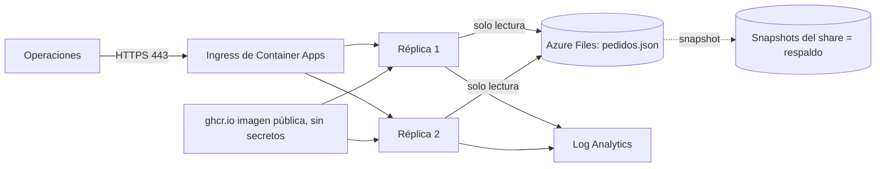

# Arquitectura equivalente en nube — DISEÑO, NO PROBADO

Lo que se probó es la solución local (ver [EVIDENCIAS.md](../EVIDENCIAS.md)). Esto es el diseño para la nube: usa la misma imagen y no cambia el código, porque `app.py` toma el hostname de la réplica cuando no hay `INSTANCE_ID`.

## Opción principal: Azure (Azure for Students)

- **Cómputo:** Azure Container Apps en plan de consumo, con `min-replicas 2` y `max-replicas 2`, y probes de liveness/readiness a `/health`.
- **Acceso:** ingress externo solo por HTTPS 443, con certificado administrado por la plataforma.
- **Datos:** Azure Files montado en las réplicas. **Respaldo:** snapshots del share.
- **Imagen:** GitHub Container Registry público, para evitar el costo fijo de Azure Container Registry.
- **Secretos y permisos:** la clave del storage se guarda como secreto de Container Apps y no va al repositorio. Las personas acceden con RBAC por grupo de recursos y mínimo privilegio.
- **Actualizaciones:** modo de una sola revisión. Para volver atrás se reactiva la revisión anterior.
- **Límite:** sin un entorno con redundancia de zona (requiere VNet), las 2 réplicas no garantizan estar en zonas distintas.

## Alternativa: AWS (solo con AWS Academy Learner Lab)
| Pieza | Azure | AWS |
|---|---|---|
| Punto de acceso | Ingress de Container Apps | Application Load Balancer |
| Cómputo | Container Apps, 2 réplicas | ECS Fargate, 2 tareas en 2 AZ |
| Datos | Azure Files | EFS |
| Respaldo | Snapshots del share | AWS Backup de EFS |
| Logs | Log Analytics (KQL) | CloudWatch Logs |
| Salud | Probes → `/health` | Health check del target group → `/health` |

## Factores de consumo que generan costo (sin cifras: se calculan con la calculadora oficial de cada proveedor)
- **Azure:** vCPU-s y GiB-s de Container Apps (tiene una concesión gratuita mensual); almacenamiento y snapshots de Azure Files; ingesta y retención de Log Analytics; salida de datos.
- **AWS:** horas y LCU del ALB; vCPU y GB por hora de Fargate; almacenamiento de EFS y de AWS Backup; ingesta de CloudWatch; salida de datos.
- **Regla:** borrar el grupo de recursos (o el stack) al terminar cada sesión de pruebas.
