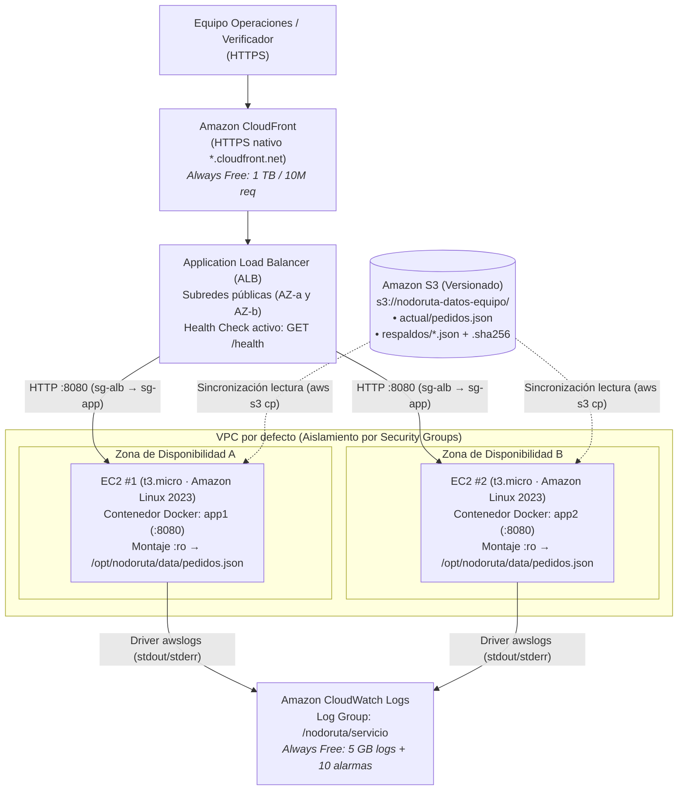

# Arquitectura e Implementación en AWS (MVP Nodo Ruta)

Propuesta reproducible para desplegar el servicio de consulta de **Nodo Ruta** en AWS aprovechando al máximo el **AWS Free Tier** (créditos iniciales del *Free Plan* / capa gratuita de 12 meses y servicios *Always Free*), eliminando los puntos únicos de fallo del entorno local (computador anfitrión, proxy NGINX único y disco local único).

---

## 1. Estrategia de Costo Cero y Factores de Consumo

* **Cobertura Free Tier:**
  * **Cuentas nuevas (Free Plan):** Créditos iniciales vigentes por 6 meses + acceso *Always Free* a CloudWatch y CloudFront.
  * **Esquema clásico (12 meses / educativo):** 750 h/mes de EC2 (`t3.micro`/`t2.micro`), 30 GB de EBS, 750 h/mes de ALB, 5 GB en S3 Standard, y límites *Always Free* en CloudWatch (5 GB de logs + 10 alarmas) y CloudFront (1 TB saliente + 10M solicitudes HTTPS/mes).
* **Servicios descartados por costo:** No se usan EKS/Kubernetes, NAT Gateway, EFS, Route 53 (zonas hospedadas) ni Elastic IPs sin asociar.
* **Cálculo de horas EC2:** Dos instancias `t3.micro` encendidas simultáneamente consumen ~2 horas de cómputo por cada hora reloj (hasta 375 horas continuas al mes dentro de las 750 horas incluidas).

---

## 2. Arquitectura en AWS



### Componentes y Factores de Consumo

| Rol en el reto | Servicio AWS | Función y mejora frente al entorno local | Factor de consumo |
| :--- | :--- | :--- | :--- |
| **Acceso público y HTTPS** | **Amazon CloudFront** | Dominio `*.cloudfront.net` con TLS/HTTPS gratuito sin comprar dominio ni zonas DNS. | Transferencia de datos saliente y solicitudes HTTPS (*Always Free* hasta límite). |
| **Balanceador y Salud** | **Application Load Balancer** | Reparte tráfico en Multi-AZ y ejecuta sondeo activo `GET /health` cada 10 s. | Horas de ALB activas y LCU consumidas. |
| **Cómputo en contenedores** | **2 × EC2 (`t3.micro`) + Docker** | Ejecutan `app1` y `app2` en zonas de disponibilidad distintas. | Horas de instancia en ejecución e IPv4 pública asociada. |
| **Datos y Respaldos** | **EBS local (`:ro`) + Amazon S3** | Montaje en solo lectura dentro del contenedor; S3 con versionado guarda respaldos y hashes SHA-256 fuera del cómputo. | GB almacenados (EBS/S3) y solicitudes PUT/GET a S3. |
| **Observabilidad** | **CloudWatch Logs + Métricas ALB** | Centraliza registros de `app1` y `app2` y monitorea `HealthyHostCount` y códigos `5xx`. | GB de ingesta/retención de logs (*Always Free* hasta 5 GB). |
| **Permisos (IAM)** | **IAM Instance Profile** | Credenciales temporales de mínimo privilegio; cero claves en código o imágenes. | Sin costo adicional. |

---

## 3. Implementación Paso a Paso

### Fase 1: Almacenamiento (S3) y Permisos (IAM)

1. **Crear bucket S3 con versionado** (reemplaza `<tu-equipo>` por un identificador único):
   ```bash
   aws s3api create-bucket --bucket nodoruta-datos-<tu-equipo> --region us-east-1
   aws s3api put-bucket-versioning --bucket nodoruta-datos-<tu-equipo> --versioning-configuration Status=Enabled
   ```

2. **Preparar datos y respaldo inicial** desde tu entorno local usando los scripts del paquete:
   ```bash
   python scripts/datos.py preparar
   python scripts/datos.py respaldar
   aws s3 cp data/pedidos.json s3://nodoruta-datos-<tu-equipo>/actual/pedidos.json
   aws s3 sync respaldos/ s3://nodoruta-datos-<tu-equipo>/respaldos/
   ```

3. **Crear rol IAM (`NodoRutaEC2Role`)** con confianza para `ec2.amazonaws.com` y adjuntar esta política en línea de mínimo privilegio:
   ```json
   {
     "Version": "2012-10-17",
     "Statement": [
       {
         "Effect": "Allow",
         "Action": ["s3:GetObject", "s3:PutObject", "s3:ListBucket"],
         "Resource": [
           "arn:aws:s3:::nodoruta-datos-<tu-equipo>",
           "arn:aws:s3:::nodoruta-datos-<tu-equipo>/*"
         ]
       },
       {
         "Effect": "Allow",
         "Action": ["logs:CreateLogGroup", "logs:CreateLogStream", "logs:PutLogEvents"],
         "Resource": "arn:aws:logs:*:*:log-group:/nodoruta/servicio:*"
       }
     ]
   }
   ```

### Fase 2: Red (Security Groups) y Cómputo (2 × EC2)

1. **Configurar Security Groups en la VPC por defecto:**
   * `sg-alb`: Entrada TCP `80` y `443` desde `0.0.0.0/0` (o prefijo administrado `com.amazonaws.global.cloudfront.origin-facing`).
   * `sg-app`: Entrada TCP `8080` **únicamente** desde `sg-alb`. Sin puerto `22` expuesto (administrar vía **AWS Systems Manager Session Manager**).

2. **Lanzar 2 instancias EC2:**
   * **AMI:** Amazon Linux 2023 | **Tipo:** `t3.micro` | **Disco:** 8 GB `gp3`.
   * **Ubicación:** Instancia 1 en subred `us-east-1a`; Instancia 2 en subred `us-east-1b`.
   * **Seguridad:** Asignar `sg-app` y el perfil IAM `NodoRutaEC2Role`.

3. **Desplegar los contenedores en cada EC2** (copia previamente `app.py` y `Dockerfile` a `/opt/nodoruta/app`):
   > *Nota:* Verifica en `app.py` / `Dockerfile` el nombre exacto de la variable de entorno que define el campo `instancia` en el JSON de respuesta (ej. `INSTANCE_ID` o `INSTANCIA`).

   ```bash
   # Instalar e iniciar Docker
   sudo dnf update -y && sudo dnf install -y docker
   sudo systemctl enable --now docker

   # Descargar datos desde S3 fuera del contenedor
   sudo mkdir -p /opt/nodoruta/data /opt/nodoruta/app
   sudo aws s3 cp s3://nodoruta-datos-<tu-equipo>/actual/pedidos.json /opt/nodoruta/data/pedidos.json

   # Construir imagen del servicio
   cd /opt/nodoruta/app
   sudo docker build -t nodoruta-consulta:1.0 .

   # Ejecutar instancia (en EC2 #1 usar app1; en EC2 #2 cambiar a app2)
   sudo docker run -d \
     --name app1 \
     --restart unless-stopped \
     -p 8080:8080 \
     -e INSTANCE_ID=app1 \
     -v /opt/nodoruta/data:/app/data:ro \
     --log-driver=awslogs \
     --log-opt awslogs-region=us-east-1 \
     --log-opt awslogs-group=/nodoruta/servicio \
     --log-opt awslogs-create-group=true \
     --log-opt awslogs-stream=app1 \
     nodoruta-consulta:1.0
   ```

### Fase 3: Balanceo (ALB) y HTTPS (CloudFront)

1. **Target Group (`tg-nodoruta`):**
   * Tipo: *Instances* | Protocolo: `HTTP` | Puerto: `8080`.
   * *Health check path:* `/health` | Código esperado: `200` | Intervalo: `10s` | Umbral saludable: `2` | No saludable: `2`.
   * Registrar las dos instancias EC2.
2. **Application Load Balancer (`alb-nodoruta`):**
   * Esquema: *Internet-facing* | Subredes: `us-east-1a` y `us-east-1b` | Security Group: `sg-alb`.
   * Listener `HTTP:80` → reenviar a `tg-nodoruta`.
3. **Distribución CloudFront:**
   * *Origin domain:* DNS público del ALB (`alb-nodoruta-xxxx.us-east-1.elb.amazonaws.com`).
   * *Protocol:* `HTTP only` (puerto `80`) | *Viewer protocol policy:* `Redirect HTTP to HTTPS`.
   * *Cache policy:* `CachingDisabled` (garantiza consultas en tiempo real sobre `/pedidos` y `/health`).

---

## 4. Validación del MVP (Pruebas I01 – I06)

Ejecuta las pruebas desde tu equipo apuntando al dominio HTTPS entregado por CloudFront (`https://<id>.cloudfront.net`):

* **I01 — Funcionamiento normal y distribución:**
  ```bash
  python scripts/verificar_servicio.py https://<id>.cloudfront.net/pedidos --esperadas app1,app2 --salida evidencias/aws_I01_inicio.json
  ```
* **I02 — Caída controlada de `app1`:**
  Detén `app1` en la EC2 #1 (`sudo docker stop app1`), observa en el Target Group cómo pasa a *Unhealthy* y ejecuta:
  ```bash
  python scripts/verificar_servicio.py https://<id>.cloudfront.net/pedidos --esperadas app2 --salida evidencias/aws_I02_fallo_app1.json
  ```
* **I03 — Recuperación de `app1`:**
  Inicia el contenedor (`sudo docker start app1`), espera a que el Target Group vuelva a *Healthy* y repite `verificar_servicio.py` con `--esperadas app1,app2`.
* **I04 — Recreación y persistencia de datos externos:**
  Recrea el contenedor en EC2 #1 (`sudo docker rm -f app1` y vuelve a ejecutar `docker run ...`) y verifica que `/pedidos` conserva la versión y los 6 registros montados desde `/opt/nodoruta/data`.
* **I05 — Corrupción de datos (HTTP 503) y restauración con SHA-256:**
  1. Corrompe la copia local y súbela a S3:
     ```bash
     python scripts/datos.py simular-error
     aws s3 cp data/pedidos.json s3://nodoruta-datos-<tu-equipo>/actual/pedidos.json
     ```
  2. Descarga el archivo corrupto en ambas EC2 (`sudo aws s3 cp ... /opt/nodoruta/data/pedidos.json`) y comprueba que `/health` y `/pedidos` devuelven **HTTP `503`** en ambas instancias.
  3. Restaura verificando integridad SHA-256, sube a S3 y sincroniza las EC2 midiendo el tiempo total hasta recuperar **HTTP `200`**:
     ```bash
     python scripts/datos.py restaurar --respaldo respaldos/<ARCHIVO>.json
     aws s3 cp data/pedidos.json s3://nodoruta-datos-<tu-equipo>/actual/pedidos.json
     ```
* **I06 — Reproducibilidad:**
  Un segundo integrante del equipo recrea una instancia o ejecuta la restauración siguiendo este documento y registra los resultados en `PLANTILLA_EVIDENCIAS.md`.

---

## 5. Plan B y Limpieza de Recursos

* **Plan B (Fallback de demo):** Si las políticas de la cuenta educativa restringen la creación de ALB o CloudFront, utiliza la EC2 #1 como proxy inverso NGINX en el puerto `8080` balanceando hacia `app1` (local) y `app2` (IP privada de EC2 #2 dentro de la misma VPC), o ejecuta la demostración local con `ayuda_opcional/compose.yaml` y presenta esta arquitectura como diseño documentado.
* **Limpieza obligatoria al terminar el ejercicio:**
  1. Deshabilitar y eliminar la distribución de **CloudFront**.
  2. Eliminar el **Application Load Balancer** y el **Target Group**.
  3. Terminar (*Terminate*) las **2 instancias EC2** (esto libera los volúmenes EBS e IPs públicas).
  4. Vaciar y eliminar el bucket **S3** (`aws s3 rb s3://nodoruta-datos-<tu-equipo> --force`).
  5. Eliminar el *Log Group* `/nodoruta/servicio` en **CloudWatch Logs**.