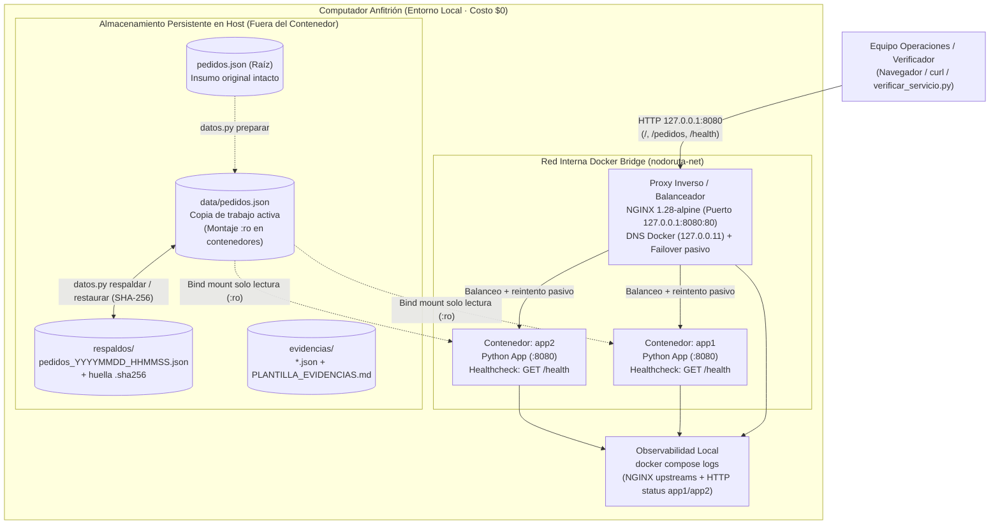

# Arquitectura e Implementación Local con Contenedores (MVP Nodo Ruta)

Guía reproducible para desplegar y validar el servicio de consulta de **Nodo Ruta** en un entorno local utilizando **Docker Compose** y **NGINX** con costo **$0**, cumpliendo con la modalidad admitida por la ficha del reto cuando no se dispone de una cuenta cloud sin cobros.

> **Declaración explícita de alcance:** Esta implementación demuestra continuidad operativa ante caída de contenedor, persistencia externa y recuperación verificada de datos en un prototipo controlado. No sustituye la tolerancia a fallos de infraestructura física ni de centro de datos; el diseño equivalente en nube queda documentado en `infra_aws.md`.

---

## 1. Arquitectura Local (Costo $0)



### Componentes y Decisiones Técnicas

| Componente | Implementación Local | Función y Justificación |
| :--- | :--- | :--- |
| **Punto de acceso común** | `127.0.0.1:8080` en **NGINX** | Expone un único puerto vinculado solo a `localhost` (`127.0.0.1`), evitando exposición innecesaria en la red local. |
| **Balanceo y Conmutación** | **NGINX (`1.28-alpine`)** | Reparte peticiones entre `app1` y `app2` usando el DNS interno de Docker (`127.0.0.11`) y reintentos pasivos (`proxy_next_upstream`) cuando una instancia deja de responder. |
| **Instancias de Servicio** | **2 Contenedores (`app1`, `app2`)** | Ejecutan `app.py` con identidad propia (`app1` y `app2`) devuelta en el campo `instancia` del JSON de respuesta. |
| **Salud de Contenedores** | `healthcheck` en Compose (`/health`) | Coordina el orden de arranque (`condition: service_healthy`) y reporta el estado en `docker compose ps`. *(Nota: Docker no retira backends de NGINX; eso lo hace el proxy de forma pasiva).* |
| **Datos Externos** | `./data/pedidos.json` (`:ro`) | Montado como *bind mount* en **solo lectura (`:ro`)** fuera de la capa efímera de los contenedores; sobrevive a recreaciones. |
| **Respaldo e Integridad** | `./respaldos/` + `scripts/datos.py` | Genera copias fuera del archivo de trabajo junto con su archivo `.sha256`, validando integridad antes de restaurar. |
| **Observabilidad** | `docker compose logs` + `verificar_servicio.py` | Permite correlacionar códigos HTTP (`200`/`503`), tiempos de respuesta y qué instancia atendió cada consulta. |

---

## 2. Implementación Paso a Paso

*(Nota para Windows: si tu sistema usa `py` en lugar de `python`, sustituye `python` por `py` en los comandos de scripts).*

### Fase 0: Verificación de Prerrequisitos y Preparación de Datos
1. **Ubícate en la carpeta raíz del paquete** (donde están `app.py`, `pedidos.json` y `Dockerfile`) y verifica las herramientas:
   ```bash
   python --version
   docker version
   docker compose version
   ```
   *(Asegúrate de que Docker Desktop / Docker Engine esté iniciado).*

2. **Prepara la copia de trabajo y crea el primer respaldo verificado** (conservando intacto el `pedidos.json` original de la raíz):
   ```bash
   python scripts/datos.py preparar
   python scripts/datos.py respaldar
   ```
   *Verifica que se hayan creado `data/pedidos.json` y dos archivos en `respaldos/` (`.json` y `.sha256`). Anota el nombre del respaldo generado.*

3. *(Opcional — reconocimiento sin contenedores)* Si ejecutaste `python scripts/ejecutar_local.py --puerto 8080 --id local-1`, detén ese proceso con **`Ctrl + C`** antes de continuar para liberar el puerto `8080`.

### Fase 1: Configuración de Contenedores y Proxy Inverso

Puedes utilizar directamente la configuración oficial en `ayuda_opcional/` o crear tus propios archivos `compose.yaml` y `nginx.conf` en la raíz del proyecto para tener control total de la infraestructura.

#### Opción A: Usar la referencia oficial (`ayuda_opcional/`)
Valida la sintaxis y rutas antes de construir:
```bash
docker compose -f ayuda_opcional/compose.yaml config
```

#### Opción B: Archivos propios en la raíz del proyecto (`compose.yaml` y `nginx.conf`)
Si prefieres definir tu propia configuración en la raíz (útil para personalizar puertos o variables), crea estos dos archivos:

**1. `nginx.conf`** (resolución dinámica con DNS de Docker `127.0.0.11` y conmutación pasiva ante fallo):
```nginx
events {
    worker_connections 1024;
}

http {
    # DNS interno de Docker para resolver app1 y app2 dinámicamente sin fallar si uno cae
    resolver 127.0.0.11 valid=10s ipv6=off;

    upstream backend_nodoruta {
        zone backend_nodoruta 64k;
        server app1:8080 max_fails=1 fail_timeout=5s resolve;
        server app2:8080 max_fails=1 fail_timeout=5s resolve;
    }

    server {
        listen 80;

        location / {
            proxy_pass http://backend_nodoruta;
            proxy_http_version 1.1;
            proxy_set_header Host $host;
            proxy_set_header X-Real-IP $remote_addr;
            proxy_connect_timeout 2s;
            proxy_read_timeout 5s;
            # Conmutación pasiva hacia la instancia sana ante error de conexión o 502/503/504
            proxy_next_upstream error timeout http_502 http_503 http_504;
            proxy_next_upstream_tries 2;
        }
    }
}
```

**2. `compose.yaml`** (orquestación de `app1`, `app2` y `nginx` con montaje `:ro`):
```yaml
services:
  app1:
    build:
      context: .
      dockerfile: Dockerfile
    container_name: nodoruta-app1
    environment:
      - INSTANCIA=app1
      - ARCHIVO_PEDIDOS=/app/data/pedidos.json
    volumes:
      - ./data/pedidos.json:/app/data/pedidos.json:ro
    healthcheck:
      test: ["CMD", "python", "-c", "import urllib.request; urllib.request.urlopen('http://127.0.0.1:8080/health')"]
      interval: 10s
      timeout: 3s
      retries: 3
      start_period: 5s
    restart: unless-stopped
    networks:
      - nodoruta-net

  app2:
    build:
      context: .
      dockerfile: Dockerfile
    container_name: nodoruta-app2
    environment:
      - INSTANCIA=app2
      - ARCHIVO_PEDIDOS=/app/data/pedidos.json
    volumes:
      - ./data/pedidos.json:/app/data/pedidos.json:ro
    healthcheck:
      test: ["CMD", "python", "-c", "import urllib.request; urllib.request.urlopen('http://127.0.0.1:8080/health')"]
      interval: 10s
      timeout: 3s
      retries: 3
      start_period: 5s
    restart: unless-stopped
    networks:
      - nodoruta-net

  nginx:
    image: nginx:1.28-alpine
    container_name: nodoruta-nginx
    ports:
      - "127.0.0.1:8080:80"
    volumes:
      - ./nginx.conf:/etc/nginx/nginx.conf:ro
    depends_on:
      app1:
        condition: service_healthy
      app2:
        condition: service_healthy
    restart: unless-stopped
    networks:
      - nodoruta-net

networks:
  nodoruta-net:
    driver: bridge
```
*(Nota: Si usas `ayuda_opcional/compose.yaml`, agrega `-f ayuda_opcional/compose.yaml` a los comandos `docker compose` de las siguientes fases).*

### Fase 2: Construcción y Arranque del Servicio
1. **Construye la imagen y levanta los 3 contenedores en segundo plano:**
   ```bash
   docker compose -f ayuda_opcional/compose.yaml up -d --build
   ```
2. **Verifica que `app1` y `app2` estén en estado `healthy` y `nginx` en `Up`:**
   ```bash
   docker compose -f ayuda_opcional/compose.yaml ps
   ```
3. **Comprueba manualmente las tres rutas del servicio:**
   ```bash
   curl -s http://127.0.0.1:8080/
   curl -s http://127.0.0.1:8080/health
   curl -s http://127.0.0.1:8080/pedidos
   ```

---

## 3. Validación del MVP (Ejecución de Pruebas I01 – I06)

Registra la hora de inicio, fin, códigos HTTP y rutas de evidencia de cada prueba en `PLANTILLA_EVIDENCIAS.md`.

### Prueba I01 — Funcionamiento normal y balanceo entre instancias
Ejecuta 10 consultas secuenciales contra el punto de acceso común y verifica que responden tanto `app1` como `app2` con HTTP `200`:
```bash
python scripts/verificar_servicio.py --esperadas app1,app2 --salida evidencias/I01_inicio.json
```

### Prueba I02 — Caída controlada de `app1` y conmutación a `app2`
1. **Anota la hora exacta de inicio de la falla** y detén únicamente `app1`:
   ```bash
   docker compose -f ayuda_opcional/compose.yaml stop app1
   ```
2. **Consulta inmediatamente por el mismo puerto `8080`** y guarda evidencia comprobando que `app2` absorbe el tráfico (registra si ocurre algún error transitorio en la primera petición antes de que NGINX marque `app1` como no disponible):
   ```bash
   python scripts/verificar_servicio.py --esperadas app2 --salida evidencias/I02_fallo_app1.json
   ```
3. **Anota la hora en que `app2` respondió correctamente** y calcula el tiempo de conmutación.

### Prueba I03 — Recuperación de `app1`
1. **Vuelve a iniciar `app1`:**
   ```bash
   docker compose -f ayuda_opcional/compose.yaml start app1
   ```
2. **Espera ~10 segundos** a que pase su `healthcheck` (`docker compose -f ayuda_opcional/compose.yaml ps`) y valida que ambas instancias vuelven a atender solicitudes:
   ```bash
   python scripts/verificar_servicio.py --esperadas app1,app2 --salida evidencias/I03_recuperacion_app1.json
   ```

### Prueba I04 — Recreación de contenedor y persistencia externa
1. **Destruye y recrea `app1` desde cero:**
   ```bash
   docker compose -f ayuda_opcional/compose.yaml up -d --force-recreate app1
   ```
2. **Verifica que los datos montados desde `./data/pedidos.json` siguen intactos** (6 pedidos y misma `version`):
   ```bash
   python scripts/verificar_servicio.py --esperadas app1,app2 --salida evidencias/I04_persistencia.json
   ```

### Prueba I05 — Corrupción de datos (HTTP 503) y restauración con huella SHA-256
1. **Asegúrate de tener un respaldo vigente** en `respaldos/` (`ls respaldos/` o `dir respaldos\`).
2. **Altera intencionalmente la copia de trabajo** (`data/pedidos.json`):
   ```bash
   python scripts/datos.py simular-error
   ```
3. **Comprueba el fallo compartido:** Como ambas instancias leen en modo `:ro` el mismo archivo `data/pedidos.json`, tanto `/health` como `/pedidos` devolverán **HTTP `503`**:
   ```bash
   curl -i http://127.0.0.1:8080/health
   python scripts/verificar_servicio.py --salida evidencias/I05_error_503.json
   ```
   *(Explica en la bitácora por qué tener dos instancias no evita este fallo: ambas comparten el mismo origen de datos).*
4. **Anota la hora de inicio de recuperación** y restaura validando la huella `.sha256` (reemplaza `ARCHIVO.json` por el nombre real en `respaldos/`):
   ```bash
   python scripts/datos.py restaurar --respaldo respaldos/ARCHIVO.json
   ```
5. **Verifica la recuperación (HTTP `200`)** y registra el tiempo total de restauración:
   ```bash
   curl -i http://127.0.0.1:8080/health
   python scripts/verificar_servicio.py --esperadas app1,app2 --salida evidencias/I05_restaurado.json
   ```

### Prueba I06 — Reproducibilidad por otro integrante
Un segundo integrante del equipo toma este documento (`infra_local.md`) y recrea una instancia o ejecuta la restauración de datos sin intervención del autor original, documentando el resultado en `PLANTILLA_EVIDENCIAS.md`.

### Observabilidad y Correlación de Registros
Consulta los registros combinados de NGINX y las instancias para correlacionar códigos HTTP con el *upstream* que respondió:
```bash
docker compose -f ayuda_opcional/compose.yaml logs --tail 50
```

---

## 4. Puntos Únicos de Fallo (SPOF), Seguridad y Equivalencia en Nube

### Puntos Únicos de Fallo Identificados en Local
1. **El computador anfitrión:** Si el equipo físico se apaga o falla, caen simultáneamente el proxy, ambas instancias, los datos y los respaldos locales.
2. **Proxy inverso único (NGINX):** Aunque existen dos instancias de aplicación (`app1` y `app2`), hay un solo contenedor NGINX en el puerto `8080`.
3. **Archivo de datos compartido (`data/pedidos.json`):** Al ser un único archivo en disco local, su corrupción provoca HTTP `503` en ambas instancias hasta ejecutar `datos.py restaurar`.

### Controles de Seguridad Aplicados
* **Sin secretos en imágenes ni repositorios:** No se almacenan credenciales ni tokens dentro del `Dockerfile` ni en `compose.yaml`.
* **Inmutabilidad en tiempo de ejecución (`:ro`):** Los contenedores montan `data/pedidos.json` en modo de solo lectura, impidiendo que un proceso comprometido dentro del contenedor altere los datos.
* **Superficie de red mínima:** Solo el puerto `127.0.0.1:8080` de NGINX es accesible desde el host; `app1` y `app2` permanecen aislados en la red interna de Docker.

### Puente hacia Arquitectura en Nube (`infra_aws.md`)
Para eliminar los 3 SPOF locales en un entorno productivo (ver detalle en `infra_aws.md`), cada componente local evoluciona así:
* **NGINX local (`127.0.0.1:8080`)** $\rightarrow$ **Amazon CloudFront (HTTPS)** + **Application Load Balancer (ALB)** con *health checks* activos sobre `/health`.
* **`app1` y `app2` en un PC** $\rightarrow$ **2 instancias EC2 (`t3.micro`) con Docker** desplegadas en dos Zonas de Disponibilidad distintas (`us-east-1a` y `us-east-1b`).
* **`data/` y `respaldos/` locales** $\rightarrow$ **Amazon S3 con versionado** + políticas **IAM de mínimo privilegio** (sin credenciales estáticas).
* **`docker compose logs`** $\rightarrow$ **Amazon CloudWatch Logs** centralizado.

---

## 5. Limpieza y Plan B (Fallback)

* **Limpieza segura al finalizar el ejercicio** (detiene y elimina contenedores y red sin borrar `data/`, `respaldos/` ni `evidencias/`):
  ```bash
  docker compose -f ayuda_opcional/compose.yaml down
  ```
* **Plan B (Si el motor de contenedores falla o está bloqueado en el equipo):**
  Ejecuta dos instancias locales de Python en terminales separadas sobre puertos distintos (`8081` y `8082`) usando `python scripts/ejecutar_local.py --puerto 8081 --id local-1` y `--puerto 8082 --id local-2`, realiza las pruebas de persistencia y respaldo con `scripts/datos.py`, y documenta explícitamente en `PLANTILLA_EVIDENCIAS.md` que la demostración se realizó sin motor de contenedores por restricción del entorno.